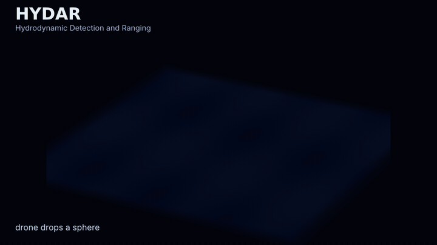
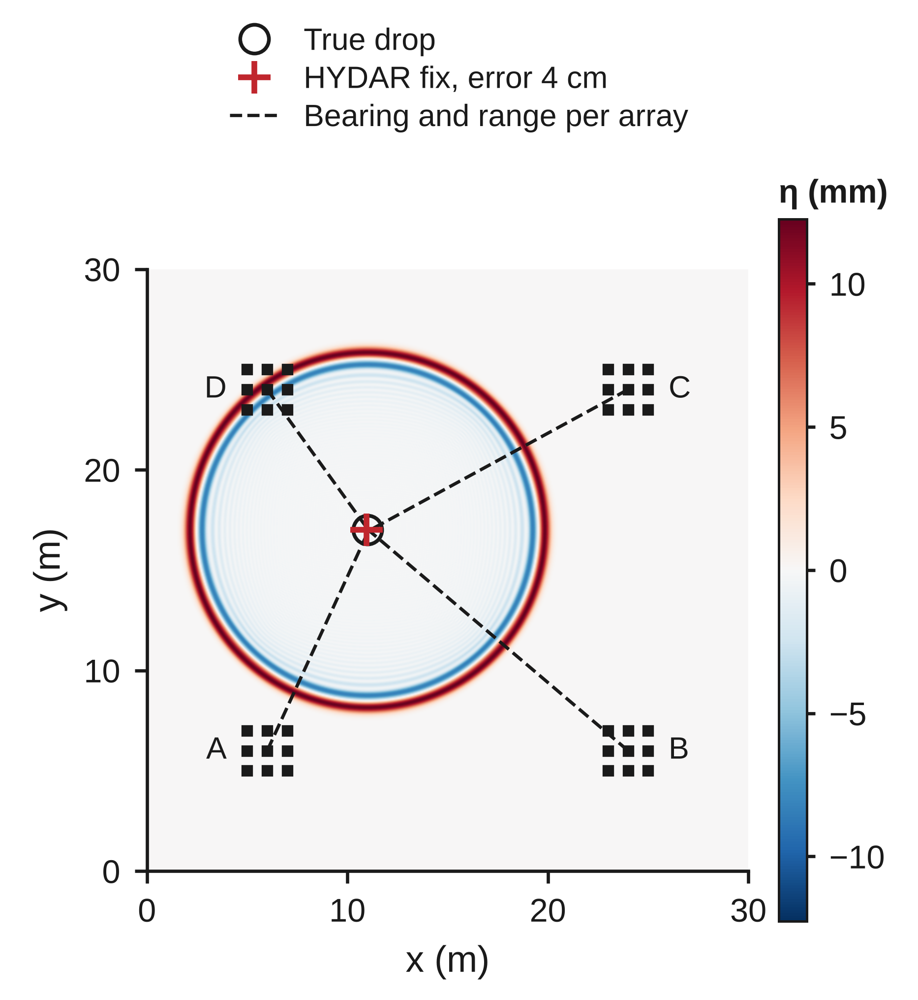
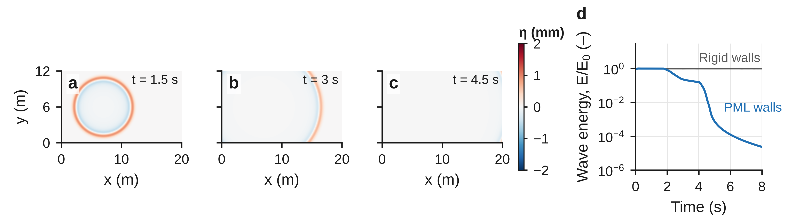
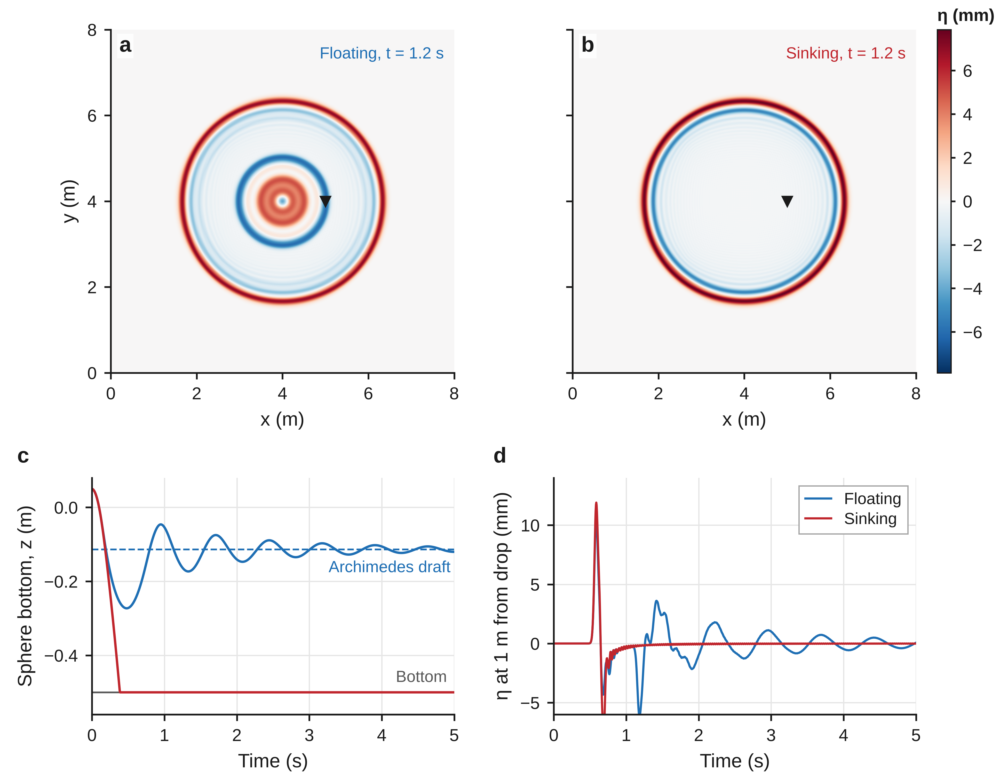
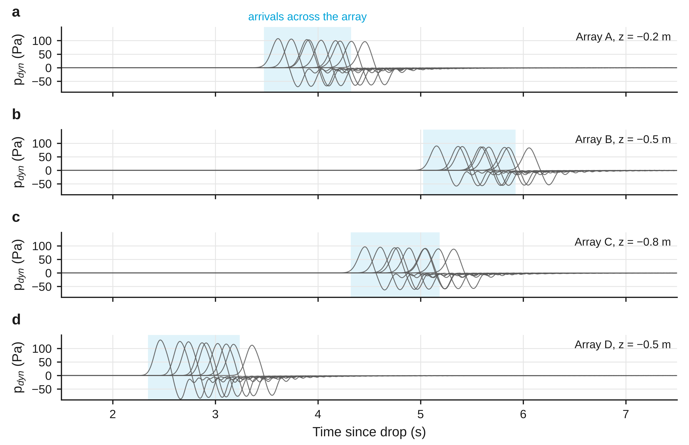
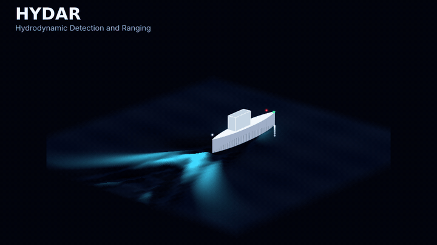
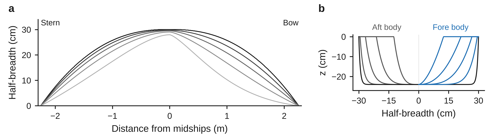
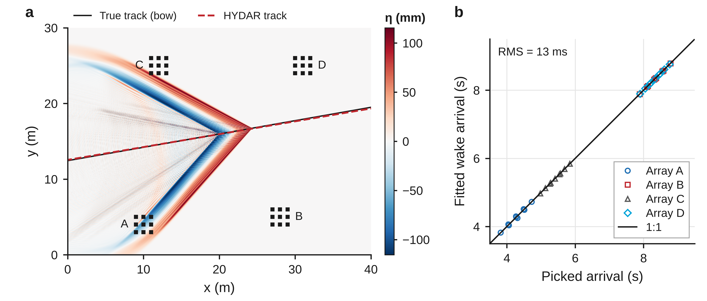
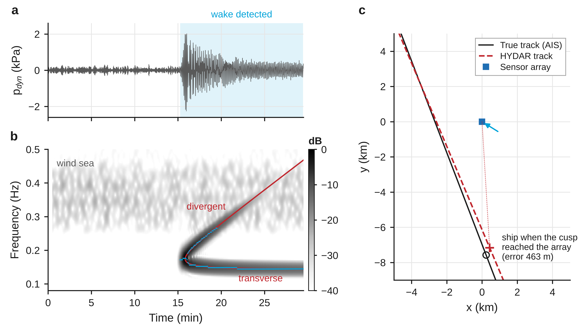
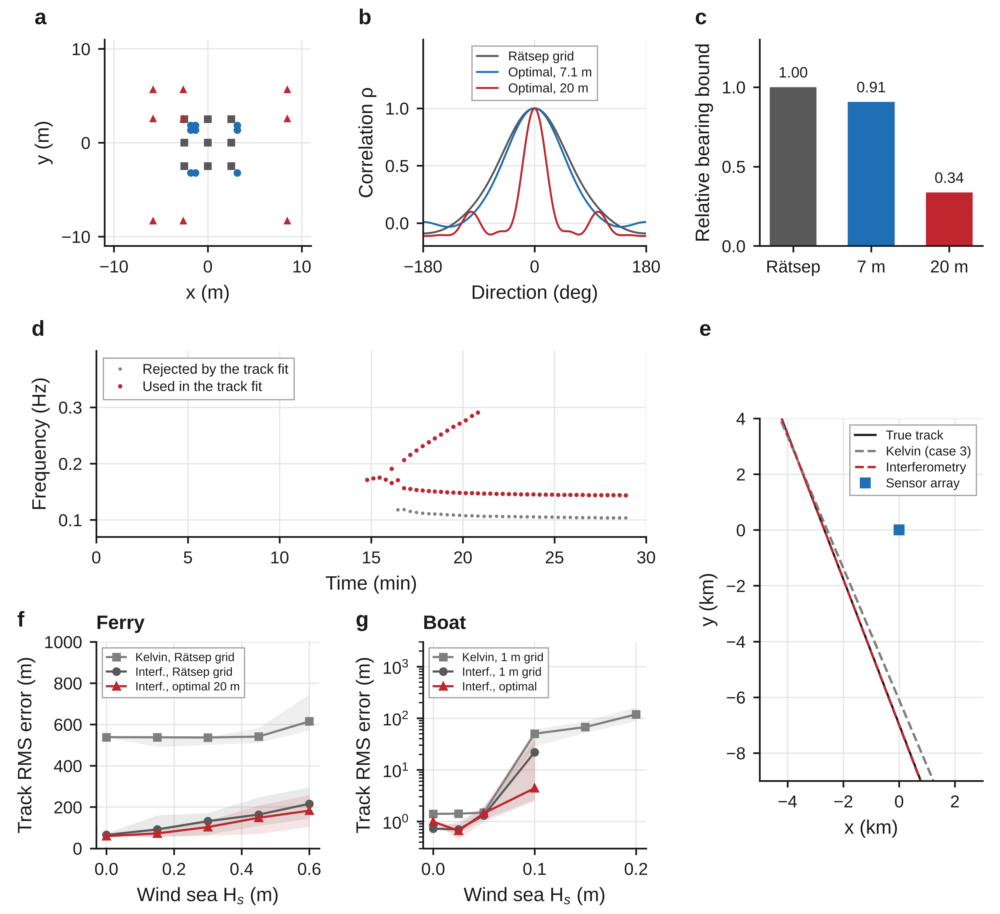

# HYDAR: Hydrodynamic Detection and Ranging

[](https://doi.org/10.5281/zenodo.23881055)

<p align="center"></p>

**HYDAR** locates objects in water from the surface waves they make. Arrays of pressure sensors record the passing waves, and the **time of flight** of the wave front gives the **direction and distance** from each array's centre to the source. HYDAR works like radar or sonar, but its signal is a water wave rather than an electromagnetic or acoustic echo.

This repository is a self-contained Python simulator for developing and testing HYDAR. It has four parts:

1. **Wave solvers.** A 2D shallow-water solver on a large rectangular domain with non-reflecting walls, and a **dispersive** linear potential-flow solver, with the exact dispersion relation, for boat wakes.
2. **Drop objects.** A sphere of chosen diameter and density is dropped at a chosen point; it sinks or floats and makes surface waves.
3. **Pressure sensor arrays.** Arrays such as 3 × 3 sensors at 1 m spacing can be placed at any x, y and depth z, and sample at 100 Hz.
4. **HYDAR localization.** Each array estimates a bearing from time differences of arrival and a range from time of flight; the arrays' estimates are then fused.

<p align="center"></p>

*A 0.5 m stone sphere is dropped at (11, 17) m in 1 m deep water; the colours show the surface elevation η 3 s later. Four 3 × 3 arrays (A to D, 1 m spacing, at depths of 0.2 to 0.8 m) each estimate a bearing and a time-of-flight range (dashed lines). The fused HYDAR fix (red cross) lands 4 cm from the true drop point (open circle).*

**Created by Jeff Tuhtan** · GitHub [@jtuhtan](https://github.com/jtuhtan) · see [Author and contact](#author-and-contact)

---

## Quick start

```bash
git clone https://github.com/jtuhtan/HYDAR-hydrodynamic-detection-and-ranging.git
cd HYDAR-hydrodynamic-detection-and-ranging
pip install -e ".[test]"

python examples/03_hydar_localization.py   # full pipeline, about 40 s
pytest                                     # 22 tests, about 4 minutes
```

```python
from hydar import Grid, Solver, DropObject, SensorArray, locate
from hydar.plotting import plot_timeseries, plot_map

# Open-water domain: 30 m x 30 m, 1 m deep, absorbing walls
sim = Solver(Grid(lx=30, ly=30, dx=0.05), depth=1.0)

# Pressure arrays: 3x3 sensors, 1 m spacing, 100 Hz, placed at (x, y, z)
arrays = [SensorArray("A", x=6,  y=6,  z=-0.2),
          SensorArray("B", x=24, y=6,  z=-0.5),
          SensorArray("C", x=24, y=24, z=-0.8)]
for a in arrays:
    sim.add(a)

# Drop a 0.5 m sphere, density 2500 kg/m^3, at (11, 17)
ball = DropObject(diameter=0.5, density=2500, x=11, y=17)
sim.add(ball)
sim.run(12.0)

# HYDAR: direction and range from each array, plus the fused position
result = locate(arrays, c=sim.c, t0=ball.t_release)   # leave out t0 if the drop time is unknown
for fix in result["fixes"]:
    print(fix)                     # bearing, range, position per array
print(result["position"])          # fused estimate

plot_timeseries(arrays, fixes=result["fixes"])   # pressure time series of every sensor
```

## Examples

| Script | What it shows |
|---|---|
| `examples/01_open_boundary.py` | A hump of water spreads out and leaves the domain. After 8 s, only 2 × 10⁻⁵ of the energy remains, so the walls behave like open water. |
| `examples/02_drop_sphere.py` | A floating sphere (600 kg/m³) heaves and settles at its Archimedes draft. A sinking one (2500 kg/m³) falls to the bottom. Both radiate rings of waves. |
| `examples/03_hydar_localization.py` | Case study 1: the full HYDAR pipeline with four arrays, with the drop time known and unknown. |
| `examples/04_boat_tracking.py` | Case study 2: a 4.5 m Series 60 boat crosses a 120 m × 50 m domain at 3 m/s. The dispersive solver computes its Kelvin wake, and HYDAR tracks the boat from that wake (about 5 minutes). |
| `examples/05_vessel_localization.py` | Case study 3: one 3 × 3 seabed array locates a ferry 2.5 km offshore from its Kelvin wake, after Rätsep et al. (2020, 2021) (about 1 minute). |
| `examples/06_array_design.py` | Case study 4: designs the optimal 3 × 3 array for correlative interferometry, then tracks the case study 3 ferry with it, without Kelvin wake theory, and compares with the Kelvin method (about 2 minutes). |
| `examples/07_benchmark_interferometry.py` | Case study 4 benchmark: Monte Carlo comparison of interferometry and the Kelvin methods of case studies 2 and 3 for accuracy, precision and wind noise (about 30 minutes on 4 cores). Writes `docs/data/ci_benchmark.csv`. |
| `examples/make_boat_animation.py` | Renders the case study 2 animation from a full simulation (needs ffmpeg, about 15 minutes). Blue lines mark the Kelvin cusp lines. Each red laser ends where the fitted HYDAR track places the boat when the cusp line first reaches that array. |
| `examples/make_hero_animation.py` | Renders the animation at the top of this page from a full simulation (needs ffmpeg, about 5 minutes). `hydar` computes the waves, arrival times and final fix; the drone and splash are decoration. |
| `docs/make_figures.py` | Regenerates the figures in this README (PNG at 600 dpi, plus editable PDF and SVG) in the author's paper figure style (`docs/paperfig.py`), sized for a 170 mm text width. |

## Case study 1: locating a dropped sphere

The map at the top of this page shows the result of example 3. Figures 1 and 2 check the two building blocks it relies on, the open boundaries and the drop object, and Figure 3 shows the pressure records that HYDAR analyses.



**Figure 1.** Non-reflecting walls. **a–c**, a 1 cm Gaussian hump of water in a 20 m × 12 m, 1 m deep domain spreads out and leaves through the perfectly matched layer (PML). **d**, wave energy remaining in the domain, relative to the start. It stays at 1 with rigid walls and falls below 10⁻⁴ with the PML.



**Figure 2.** Drop objects. A 0.2 m sphere is released 5 cm above 0.5 m deep water. **a**, a floating sphere (600 kg/m³) keeps radiating rings as it bobs; **b**, a sinking sphere (2500 kg/m³) makes a single ring. **c**, height of the sphere's lowest point: the floating sphere settles at its Archimedes draft (dashed), the sinking sphere stops on the bottom. **d**, surface elevation at the wave gauge 1 m from the drop (triangle in a and b).



**Figure 3.** Dynamic pressure recorded at 100 Hz by the nine sensors of each array (**a–d** = arrays A–D) for the drop in the map at the top of the page. The shaded band spans the first to the last picked arrival on each array. This spread in arrival time gives the bearing; the arrival time at the array centre gives the range.

---

## Case study 2: tracking a small boat from its Kelvin wake

<p align="center"></p>

A 4.5 m boat with a **Series 60** hull (beam 0.60 m, draft 0.24 m, 389 L displacement) runs at 3 m/s on a heading of 4° through 3 m deep water. Its speed is about 6 knots, a length Froude number of 0.45. Four 3 × 3 arrays, at depths of 0.3 to 0.8 m, record the dynamic pressure at their own depth at 100 Hz.

Boat waves are dispersive: long waves travel faster than short ones. Dispersion shapes the familiar **Kelvin wake**, with transverse waves behind the boat and diverging waves inside a wedge of half-angle 19.47°. The shallow-water solver cannot produce this pattern, so this case study uses `SpectralSolver`, a linear potential-flow model with the exact dispersion relation (Theory, section 1b).

HYDAR picks the moment the wake's **cusp line** passes each of the 36 sensors and fits a straight, constant-speed track to those times.

| | True | HYDAR |
|---|---|---|
| Speed | 3.00 m/s | 3.06 m/s |
| Heading | 4.0° | 3.7° |
| Distance from the hull centre at t = 20, 30, 40 s | | 0.7, 1.3, 2.0 m |
| RMS misfit of the 36 picks | | 115 ms |

```python
from hydar import Boat, Grid, SensorArray, SpectralSolver, track_boat
from hydar.boat import Series60Hull

grid = Grid(lx=120.0, ly=50.0, dx=0.125, n_pml=80)        # 10 m absorbing sponge
sim = SpectralSolver(grid, depth=3.0, dt=0.01)
arrays = [SensorArray("A", 50.0, 14.0, z=-0.3, pressure_model="solver"), ...]
for a in arrays:
    sim.add(a)
sim.add(Boat(hull=Series60Hull(length=4.5), speed=3.0, x=-8.0, y=22.0, heading_deg=4.0, ramp=4.0))
sim.run(44.0)
track = track_boat(arrays)            # Kelvin wake: speed, heading, position at t = 0
print(track.position(30.0))           # where the boat was at t = 30 s
```



**Figure 4.** The Series 60 hull used in the boat case study, scaled to L = 4.5 m. **a**, half-breadth plan with waterlines at 0, 25, 50, 75 and 95 % of the draft (dark to light). **b**, body plan: stations 1 to 4 of the aft body on the left and stations 6 to 9 of the fore body on the right, with the midship section (black) on both sides. As built, the hull has C_B = 0.600, C_P = 0.614, C_M = 0.977, C_WP = 0.706 and its LCB 1.5 % L aft of midships.



**Figure 5.** HYDAR tracking of the boat from its Kelvin wake. **a**, surface elevation 30 s after the start, computed with the dispersive solver: transverse waves behind the boat and diverging waves along the 19.47° cusp lines. The HYDAR track (dashed red) lies on the true track (black). **b**, dynamic pressure at the nine sensors of array A (0.3 m deep), with the picked cusp-line passages (red). **c**, picked cusp passages at all 36 sensors against those predicted by the fitted track; the RMS misfit is 115 ms.

**How the boat tracking works.** In deep water, two cusp lines at the Kelvin angle μ = arcsin(1/3) = 19.47° bound a boat's wake, whatever the boat's speed. The cusp line crosses a point a distance s along the track and d to the side at t = (s + d cot μ) / U = (s + 2√2 d) / U.

To time that crossing, `pick_wake` uses the shape of the wave envelope. Across a cusp line the wave amplitude follows an Airy function: it grows from zero ahead of the line, reaches Ai(0) = 0.355 on the line and peaks at 0.536 just behind it. `pick_wake` therefore band-passes each record, takes its envelope, and picks the time the envelope first reaches 0.355/0.536 = 66 % of its first maximum. A simple first-threshold pick fails for a wake, because the oscillating signal crosses any threshold on a different crest at each sensor.

`track_boat` then fits the boat's position at t = 0, its heading and its speed to the 36 picks by least squares, starting from several initial guesses. When the boat starts, it sends a weak train of long waves ahead of it. To keep these start-up waves out of the picks, the boat starts inside the absorbing layer and the arrays sit at least 50 m down the track, where the wake is fully developed.

---

## Case study 3: locating a passing ferry from its Kelvin wake

This case study follows the field work of Rätsep et al. ([2020](https://doi.org/10.1175/JTECH-D-19-0192.1), [2021](https://doi.org/10.1016/j.oceaneng.2021.109156)) in Tallinn Bay. A 3 × 3 grid of seabed pressure sensors (2.5 m spacing, 0.2 m above the bed in 3 m of water, 100 Hz) records the wakes of fast ferries passing about 3 km offshore. These ships are slower than the long-wave speed of the deep fairway, so they make a **dispersive Kelvin wake**. Simulating a domain 3 km wide with the dispersive solver of case study 2 would be very costly. Instead, the wake is synthesized from linear deep-water theory by integrating the Havelock wave spectrum numerically, which makes the cusp and both wave branches exact. A random wind sea (H_s = 0.15 m, 0.4 Hz) and sensor noise are added, and the pressure at the sensor depth follows the Airy depth response.

In the example, a ferry sails at 11 m/s (21 kn) on a course of 159°, 2.5 km from the array. The analysis uses only the recorded pressures and follows the steps of the papers:

1. **Detection.** Averaging the spectrograms of five sensors (four corners and the centre) suppresses incoherent noise ([2020](https://doi.org/10.1175/JTECH-D-19-0192.1)). The wake is flagged where its band power rises above the background.
2. **Speed, distance and time abeam from the spectrogram.** A fixed observer a distance d from the track sees two branches: transverse waves whose frequency falls towards f_t = g/(2πU), and divergent waves whose frequency rises. Both start at the cusp, at √(3/2)·f_t. Fitting the two stationary-phase branches to the spectrogram ridge gives U, d and the time the ship passed abeam. The upper divergent branch is hidden under the wind sea, as noted in the papers, so the fit uses the band below it.
3. **Wake direction from time delays.** Cross-correlating all 36 sensor pairs gives the delay of the same waves between sensors. A plane-wave fit to those delays gives the direction the cusp waves travel ([2021](https://doi.org/10.1016/j.oceaneng.2021.109156)).
4. **Course and position.** At the cusp, the waves travel at 35°16′ to the ship's course, so each wave direction fits two candidate courses. In the field, the coastline resolved this ambiguity. Here, the late transverse waves travel along the course, and their direction selects the correct candidate. The distance d and the side of the track the waves came from then place the ship.

| | True | HYDAR (case study 3) |
|---|---|---|
| Speed | 11.00 m/s | 10.99 m/s |
| Distance from track | 2500 m | 2390 m |
| Course | −69.0° (159° nautical) | −67.1° |
| Ship position when the cusp reaches the array | | 463 m off |

For comparison, the field study reported positions mostly within 0.5 km of the AIS positions, with about 400 m in its example case.

```python
from hydar import SensorArray
from hydar.kelvin import KelvinShip, record_passage, locate_vessel

array = SensorArray("H", 0, 0, z=-2.8, spacing=2.5, rotation_deg=22.5, pressure_model="airy")
ship = KelvinShip(speed=11.0, course_deg=-69.0, x0=..., y0=...)     # see examples/05
record_passage([array], ship, t_end=1800, depth=3.0, wind={"hs": 0.15, "f_peak": 0.4})
fix = locate_vessel(array)       # speed, distance, course, ship position at any time
```



**Figure 6.** Case study 3, after Rätsep et al. (2020, 2021). **a**, dynamic pressure at the centre sensor: wind-sea noise, then the ferry wake 15 min after the ship passed abeam. **b**, spectrogram averaged over five sensors. The fitted Kelvin branches (red) follow the ridge points (cyan); the upper divergent branch disappears under the wind sea. **c**, the true track (black) and the HYDAR track (dashed red) from the single 3 × 3 array (blue). The arrow shows the measured direction of the cusp waves; the markers show the ship when the cusp reached the array, true (circle) and estimated (cross).

**Assumptions.** The model assumes deep water along the whole wave path, so it ignores refraction and shoaling as the waves enter the 3 m deep nearshore. It also represents the hull by a smooth amplitude spectrum rather than a specific ship. The spectrogram relations used here are derived in `hydar/kelvin.py` from stationary phase; the papers state the same physics in terms of the cusp and limiting transverse frequencies.

## Case study 4: array design and ship tracking by correlative interferometry

Case studies 2 and 3 locate a vessel with **Kelvin wake theory**: the 19.47° cusp line (case 2), and the Kelvin chirp and 35.26° cusp angle (case 3). This case study asks two questions. Can a 3 × 3 array detect and track a ship **without** that theory? And which 3 × 3 geometry does it best? The method, `hydar.interferometry`, uses only two facts that hold for the steady wave pattern of any source moving at a constant velocity **V**, in any depth:

1. **Stationarity.** A wave of the steady pattern does not move relative to the source. A wave with direction **n**, frequency ω and phase speed c(ω) from the dispersion relation therefore obeys **n · V = c**.
2. **Rays.** That wave's energy left the source when it was at **P**(t_e) = **P**₀ + **V** t_e and reached the sensor at **r** at time t travelling at the group speed c_g: **P**₀ + **V** t_e + c_g **n** (t − t_e) = **r**.

The Kelvin angle, the cusp and the chirp all follow from these two equations in deep water, but the method does not assume any of them. It also holds in finite depth and for hulls whose wake shows no clean cusp.

**How it works.**

1. **Correlative interferometry.** In sliding windows, the cross-spectra of all 36 sensor pairs are compared, frequency by frequency, with the phases a plane wave from each candidate direction would produce. This is the reference-table principle of correlative-interferometer direction finders in radio. The best match gives the wave direction **n** and a correlation ρ between 0 and 1 that measures how plane the wave field is.
2. **Detection.** A (time, frequency) cell becomes an observation when ρ ≥ 0.9 (a coherent wave crosses the array) and its power is at least 3 times the median of that frequency over the record (something transient has arrived). A stationary wind sea sits at the median and fails the second test.
3. **Tracking.** Every observation, from any number of arrays, gives one linear equation for **V** (stationarity) and, once **V** is known, one for **P**₀ (rays). A RANSAC search finds the velocity and start position that most observations agree with. The ray equation rejects wind waves, because the same wind-wave direction seen in many windows cannot come from one point on a moving source. A robust least-squares fit (Cauchy loss) then refines **P**₀ and **V**. The result is a constant-velocity track, like those of case studies 2 and 3.

**Array design.** For a plane wave of wavenumber k, the Cramér-Rao bound on the bearing is var(θ) ≥ 1 / (2 SNR k² Σᵢ ((**r**ᵢ − **r̄**) · **t**_θ)²), with **t**_θ normal to the wave direction. A wider aperture therefore measures the bearing better. But once the spacing exceeds half a wavelength, a regular grid **aliases**: its correlation pattern grows grating lobes as high as the true peak, and in noise the wrong lobe can win. `design_array` searches 3 × 3 grids whose middle column and middle row may sit anywhere between the outer ones, so the grid can be non-uniform and rectangular. It minimizes the mean bearing bound over the frequency band and all directions, subject to a highest sidelobe of 0.6, a maximum footprint and a minimum spacing, using differential evolution.

| Case (band) | Geometry | Sensor columns, rows (m) | Footprint | Peak sidelobe | Bearing bound |
|---|---|---|---|---|---|
| Ferry (0.07 to 0.3 Hz, deep water) | Rätsep et al. grid | 2.5 m spacing | 7.1 m | none | 1 |
| | Optimal, same footprint | gaps 0.5 and 4.45; 4.55 and 0.5 | 7.1 m | 0.02 | 0.91 |
| | Optimal, 20 m footprint | gaps 3.2 and 11.1; 10.9 and 3.1 | 20 m | 0.61 | 0.34 |
| Boat (0.45 to 1.2 Hz, 3 m depth) | 1 m grid of case study 2 | 1 m spacing | 2.8 m | 1.00 (aliased above 0.9 Hz) | 1 |
| | Optimal, same footprint | gaps 1.56 and 0.46; 0.45 and 1.53 | 2.8 m | 0.60 | 0.95 |

Within the same footprint, the best grid puts the middle column and row close to one edge. This adds aperture where it counts but only lowers the bound by 5 to 9 %. The 1 m grid of case study 2 aliases at the short end of the boat's wake band, and the optimal grid removes that ambiguity. In the ferry case, the waves are 20 to 250 m long, so a wider footprint helps most: 20 m cuts the bearing bound to a third.

```python
from hydar import SensorArray
from hydar.interferometry import design_array, track_vessel

design = design_array(band=(0.07, 0.3), max_aperture=20.0)             # deep water by default
array = SensorArray("H", 0, 0, z=-2.8, layout=design.offsets, rotation_deg=22.5, pressure_model="airy")
# ... record a passage as in case study 3 ...
track = track_vessel([array], band=(0.07, 0.3), window=120.0, hop=20.0)
print(track.speed, track.heading_deg, track.position(600.0))
```

**Benchmark.** `examples/07_benchmark_interferometry.py` runs both earlier vessel scenarios with 20 random wind seas (and sensor noise) at each wind-sea height H_s, on every geometry, and analyses each record with both methods. For the boat, the wind sea is added to the dispersive-solver pressures with the finite-depth depth attenuation (`wind_sea_head`, peak at 0.8 Hz, inside the wake band). Accuracy is the mean error (bias), precision is its standard deviation, and the track error is the RMS distance from the true track over the record. All rows are in [`docs/data/ci_benchmark.csv`](docs/data/ci_benchmark.csv).

*Ferry (case study 3), one array 2.5 km from the track, wind sea at 0.4 Hz:*

| H_s | Method, geometry | Fixes | Speed bias ± SD (m/s) | Course bias ± SD (°) | Track RMS, median (90 %) |
|---|---|---|---|---|---|
| 0 | Kelvin, Rätsep grid | 20/20 | −0.005 ± 0.000 | +2.03 ± 0.00 | 538 m (539 m) |
| 0 | Interferometry, Rätsep grid | 20/20 | +0.004 ± 0.000 | −0.08 ± 0.00 | 65 m (82 m) |
| 0 | Interferometry, optimal 20 m | 20/20 | +0.005 ± 0.000 | −0.08 ± 0.00 | 59 m (63 m) |
| 0.3 m | Kelvin, Rätsep grid | 19/20 | −0.009 ± 0.006 | +2.00 ± 0.05 | 537 m (566 m) |
| 0.3 m | Interferometry, Rätsep grid | 20/20 | +0.002 ± 0.003 | −0.04 ± 0.07 | 132 m (268 m) |
| 0.3 m | Interferometry, optimal 20 m | 20/20 | +0.003 ± 0.002 | −0.05 ± 0.04 | 103 m (159 m) |
| 0.6 m | Kelvin, Rätsep grid | 20/20 | −0.020 ± 0.014 | +1.98 ± 0.29 | 615 m (829 m) |
| 0.6 m | Interferometry, Rätsep grid | 20/20 | −0.001 ± 0.004 | +0.03 ± 0.09 | 216 m (384 m) |
| 0.6 m | Interferometry, optimal 20 m | 20/20 | −0.000 ± 0.003 | +0.01 ± 0.06 | 183 m (293 m) |

*Boat (case study 2), four arrays 8 to 18 m from the track, wind sea at 0.8 Hz:*

| H_s | Method, geometry | Fixes | Speed bias ± SD (m/s) | Course bias ± SD (°) | Track RMS, median (90 %) |
|---|---|---|---|---|---|
| 0 | Kelvin, 1 m grid | 20/20 | +0.064 ± 0.001 | −0.27 ± 0.00 | 1.40 m (1.40 m) |
| 0 | Interferometry, 1 m grid | 20/20 | +0.033 ± 0.000 | +0.41 ± 0.01 | 0.72 m (0.73 m) |
| 0 | Interferometry, optimal | 20/20 | +0.025 ± 0.000 | +0.52 ± 0.01 | 0.99 m (0.99 m) |
| 0.025 m | Kelvin, 1 m grid | 20/20 | +0.062 ± 0.016 | −0.27 ± 0.07 | 1.41 m (1.50 m) |
| 0.025 m | Interferometry, 1 m grid | 20/20 | +0.026 ± 0.013 | +0.48 ± 0.40 | 0.70 m (1.43 m) |
| 0.025 m | Interferometry, optimal | 20/20 | +0.013 ± 0.015 | +0.67 ± 0.42 | 0.66 m (1.05 m) |
| 0.05 m | Kelvin, 1 m grid | 20/20 | +0.059 ± 0.036 | −0.23 ± 0.23 | 1.49 m (1.73 m) |
| 0.05 m | Interferometry, 1 m grid | 20/20 | +0.021 ± 0.026 | +0.61 ± 0.83 | 1.31 m (2.47 m) |
| 0.05 m | Interferometry, optimal | 20/20 | +0.001 ± 0.036 | +1.18 ± 1.27 | 1.44 m (2.47 m) |
| 0.1 m | Kelvin, 1 m grid | 20/20 | +0.90 ± 2.23 | +12.7 ± 64.9 | 50 m (77 m) |
| 0.1 m | Interferometry, 1 m grid | 15/20 | −0.09 ± 0.15 | +7.6 ± 9.8 | 22 m (84 m) |
| 0.1 m | Interferometry, optimal | 17/20 | +0.06 ± 0.40 | −2.2 ± 20.2 | 4.4 m (106 m) |

**What the benchmark shows.**

* **Ferry: interferometry wins on every measure, in every wind.** The Kelvin method of case study 3 carries a fixed course bias of about 2° and a track error of about 540 m, which the wind then increases. Interferometry has no course bias to speak of (below 0.1°), a speed bias below 0.01 m/s and a track error 3 to 9 times smaller. It returned a fix in all 300 runs, while the Kelvin method missed 7 of 300. The optimal 20 m array cuts the interferometry error further at every wind height, by 9 to 22 % in the median and by 23 to 45 % in the 90th percentile. The optimal array with the same footprint helps in calm water (45 m against 65 m) but not in wind.
* **Boat: interferometry wins in calm water and light wind, but not in moderate wind.** Up to H_s = 0.025 m it roughly halves the track error and the speed bias. Its course, however, carries a bias of +0.4 to +0.7°, against −0.27° for the cusp-line method, and its course spread is larger. At H_s = 0.05 m the median track errors are equal, but the cusp-line method is more precise: course spread 0.23° against 0.8 to 1.3°, and a smaller 90th percentile. The boat's wake lasts only a few seconds at each array and overlaps the wind sea in frequency, so the four arrays together yield only about 60 coherent observations, while the cusp-line pick averages the envelope over the whole wake band. From H_s = 0.1 m both methods break down. The Kelvin method still returns a track every time, with errors of tens of metres. Interferometry returns no track in 3 to 5 of 20 runs at H_s = 0.1 m and in most or all runs above that, which at least flags the failure.
* **Geometry.** For the boat, the optimal grid removes aliasing and helps in light wind (90th percentile 1.05 m against 1.43 m) and at H_s = 0.1 m (median 4.4 m, 17 of 20 fixes, against 22 m and 15 of 20). In calm water and at H_s = 0.05 m it is no better than the 1 m grid.

So the claim holds for the ferry and does not hold in general for the boat. In the ferry case, interferometry is more accurate, more precise and more robust to wind than the Kelvin method, and the optimized array adds to that. In the boat case, interferometry is more accurate in calm water, but in moderate wind the cusp-line method is more precise.



**Figure 7.** Case study 4. **a**, the Rätsep et al. grid (grey squares) and the optimal 3 × 3 grids for the ferry band with the same 7.1 m footprint (blue) and a 20 m footprint (red). **b**, their correlation patterns at 0.3 Hz for a wave from 0°: the wide grid has a narrow main lobe and low sidelobes. **c**, their bearing Cramér-Rao bounds relative to the Rätsep grid. **d**, the interferometric observations of one ferry passage (optimal 20 m grid, wind sea H_s = 0.3 m): the transverse branch, the divergent branch and the cusp emerge from direction finding alone, without a Kelvin model. The grey cells are spectral-leakage sidelobes of the strong transverse peak, rejected because they do not fit a single moving source. **e**, the true track, the Kelvin track of case study 3 and the interferometry track, from the same record. **f**, **g**, median track error (shading: 25th to 75th percentile, 20 runs) against wind-sea height for the ferry and the boat. A point is missing where fewer than half the runs gave a fix.

**Assumptions.** The ferry wake is synthesized with deep-water dispersion (as in case study 3), so the interferometry uses deep-water dispersion there too; the boat case uses the 3 m depth of the solver. Both methods assume a straight track at constant speed. The wind sea is linear, so it is added to the recorded wake. The plane-wave model needs the aperture to be small compared with the distance to the track, which limits how wide an array can usefully be for near targets. The analysis windows (120 s for the ferry, 6 s for the boat) are chosen per scenario; for the boat, where the source moves 18 m in one window, each cell is dated by the power-weighted time of its wave group (`time_stamp="centroid"`) rather than the window centre.

---

## Theory

### 1. Wave model

The domain is the horizontal free surface. The unknowns are the surface elevation η(x, y, t) and the depth-averaged velocity (u, v). For still water of uniform depth h, the linear shallow-water equations are

$$
\frac{\partial \eta}{\partial t} = -h\left(\frac{\partial u}{\partial x}+\frac{\partial v}{\partial y}\right) + q(x,y,t),\qquad
\frac{\partial u}{\partial t} = -g\frac{\partial \eta}{\partial x},\qquad
\frac{\partial v}{\partial t} = -g\frac{\partial \eta}{\partial y}
$$

Waves travel at $c=\sqrt{gh}$, and $q$ is a volume source per unit area through which objects push water aside. The solver uses second-order finite differences on a staggered (Arakawa C / Yee) grid, with a time step $\Delta t = \mathrm{CFL}\,\Delta x / c$ and CFL = 0.5 by default.

### 1b. Dispersive solver (boat wakes)

`SpectralSolver` keeps the full linear free-surface physics for inviscid, irrotational flow. In Fourier space, every wavenumber k of the surface elevation $\hat\eta$ and of the surface velocity potential $\hat\phi$ is a harmonic oscillator,

$$
\frac{\partial \hat\eta}{\partial t} = k\tanh(kh)\,\hat\phi,\qquad
\frac{\partial \hat\phi}{\partial t} = -g\,\hat\eta - \frac{\hat P}{\rho},
$$

with the exact dispersion relation $\omega^2 = gk\tanh(kh)$, valid from shallow to deep water. The solver advances each oscillator exactly over a time step, holding the applied surface pressure P at its mid-step value. It therefore has no stability limit and no numerical dispersion.

The boat enters as the classical **pressure patch** of linear ship-wave theory (Wehausen and Laitone, 1960), $P=\rho g D(x,y,t)$, where D is the hull draft. Sensors with `pressure_model="solver"` read the dynamic pressure at their own depth directly, $p_{dyn}/(\rho g)=\mathcal F^{-1}[(\hat\eta+\hat P/\rho g)\cosh k(h+z)/\cosh kh]$.

Because the FFT makes the domain periodic, the walls are a **sponge layer** that damps η and φ by $e^{-\sigma\Delta t}$, with σ growing quadratically to 3 s⁻¹ at the edge. Tests check the standing-wave frequency against the dispersion relation, and check that less than 10⁻³ of the wave energy remains once the waves have left the domain.

### 2. Non-reflecting walls

The physical domain is wrapped in a split-field **perfectly matched layer** (PML; Bérenger, 1994), 40 cells thick by default. Inside the layer, η is split into $\eta_x+\eta_y$, and each part is damped only in its own direction by $\sigma(d)=\sigma_{\max}(d/L)^2$, where $\sigma_{\max} = -3c\ln R/(2L)$ and R = 10⁻⁶. Waves enter the layer without reflection and decay there, so a finite box behaves like an unbounded lake. The test suite checks that less than 10⁻⁴ of the wave energy remains after the waves have crossed the domain twice. With rigid walls, over 30 % remains.

### 3. Drop object

A sphere of diameter D and density ρₛ is released from rest at (x, y), optionally from a height above the surface and at a chosen release time. Several drops can share one simulation. The sphere moves vertically under gravity, buoyancy, added mass and quadratic drag:

$$
(m + C_a\rho_w V_{sub})\,\dot w = \rho_w g V_{sub} - m g - \tfrac12 \rho_w C_d A\, w|w|
$$

Here $V_{sub}$ is the spherical-cap volume below the local water level, and $C_a = 0.5$ and $C_d = 0.5$ by default. As the sphere crosses the surface, the rate of change of submerged volume, $\dot V_{sub}$, enters as the source q over the waterline disc. The volume of water raised in the domain therefore equals the volume the sphere displaces; the tests verify this to within 2 %. The water level around the sphere is fed back into $V_{sub}$, so a floating sphere also responds to the waves it radiates (two-way coupling). Spheres lighter than water settle at the Archimedes draft. Heavier ones sink and stop on the bottom at $z = -h + D/2$.

**Resolution.** The sphere should span at least 8 to 10 grid cells (Δx ≤ D/10 is recommended), and the code warns if it spans fewer. `recommend_grid(D, h)` suggests Δx and a domain size.

### 4. Pressure sensors

A `SensorArray` is an n_x × n_y grid of sensors (3 × 3 at 1 m by default) centred at (x, y) and mounted at depth z < 0. η is interpolated bilinearly to each sensor at every solver step and resampled at `fs` = 100 Hz. The solver step must be shorter than 1/fs, and the code checks this. Gauge pressure is the hydrostatic head plus a dynamic part:

$$
p(t) = \rho g(-z) + p_{dyn}(t)
$$

* `pressure_model="hydrostatic"` (default): $p_{dyn}=\rho g\eta$. This matches the shallow-water solver and is used for HYDAR picking.
* `pressure_model="airy"`: linear (Airy) wave theory attenuates each frequency component with depth, $K_p=\cosh k(h+z)/\cosh kh$ with $\omega^2 = gk\tanh kh$. This model shows how strongly a deep array filters short waves. Because the filter is zero-phase, it smears sharp fronts slightly earlier in time, so do not use it for arrival picking.
* `pressure_model="solver"`: the dispersive `SpectralSolver` supplies the dynamic pressure at the sensor depth directly (section 1b). Case study 2 uses this model.

### 5. Boat

`Boat` moves a hull along a straight line at constant speed. In the dispersive `SpectralSolver`, the hull's depth below the waterline, D(x, y, t), acts as the surface pressure head P/(ρg) (section 1b). In the shallow-water `Solver`, its rate of change q = ∂D/∂t enters as the volume source instead. This source pushes water out ahead of the bow and lets it flow back behind the stern. It integrates to zero, and the water raised around the hull equals the displaced volume (tested to within 3 %). In both solvers, the boat can start inside the absorbing layer so that it enters the domain already at speed.

The default `Series60Hull` follows the Series 60 parent form (Todd, 1963): L/B = 7.5, B/T = 2.5, C_B = 0.60, C_P = 0.614, C_M = 0.977, C_WP = 0.706, LCB 1.5 % L aft. Rather than reproduce the published offset table, the code fits smooth curves to exactly these coefficients:

* the sectional-area curve $A(\xi)=A_M(1-|\xi|^{n})$, with separate fore and aft exponents that set C_P and the LCB;
* the waterline $b(\xi)=\tfrac{B}{2}(1-|\xi|^{m})$, with m set by C_WP;
* section depth profiles $D = T\,(1-|y/b|^{k})$, with k chosen to give each section its area.

The principal dimensions, displacement, prismatic distribution and LCB therefore match Series 60, while the detailed section shapes are approximate. `Series60Hull.coefficients()` reports the values achieved, and a test checks them to ±0.003. An `EllipseHull` is also available.

### 6. HYDAR localization

Each array acts as a small sonar receiver. For a drop, HYDAR works in four steps.

1. **Arrival picking.** At each sensor, the arrival time $t_i$ is the first time $|p_{dyn}|$ exceeds a fraction (10 % by default) of the array's peak, interpolated between samples.
2. **Direction from time differences of arrival.** Across a small array the front is nearly plane, so $t_i = \tau + \mathbf{s}\cdot(\mathbf r_i-\mathbf r_c)$. A linear least-squares fit gives the slowness vector **s**, and the source lies in the direction $-\mathbf s/|\mathbf s|$ from the array centre. The fitted apparent speed $1/|\mathbf s|$ should match $c$, which serves as a quality check.
3. **Range from time of flight.** When the drop time $t_0$ is known, $r = c\,(\tau - t_0)$, as in radar ranging. Bearing and range together give a position from a single array.
4. **Fusion across arrays.** A circular front, $t_i = t_0 + |\mathbf r_i - \mathbf x_s|/c$, is fitted to all arrival times together, solving for the source position $\mathbf x_s$ and, if it is unknown, $t_0$. The intersection of the bearing lines provides the initial guess. Because $t_0$ can be fitted, a constant picking delay cancels out, and the method also works when the time the object entered the water is unknown.

In example 3, every bearing is within 0.4° of the truth, the single-array ranges are within 0.2 m over distances of 8 to 17 m, and the fused position is within 0.05 m, whether or not the drop time is known. A moving boat needs a different model of the wave front; case study 2 describes it.

---

## Assumptions and limitations

* **Shallow-water physics (drop case).** The drop examples use the shallow-water `Solver`. Because it is linear and non-dispersive, it is valid only for waves much longer than the depth and for amplitudes much smaller than the depth. Real waves from objects smaller than the water depth are dispersive: longer waves outrun shorter ones, and the front spreads out. The dispersive `SpectralSolver` could also model the drop case, but arrival picking would then have to account for the group velocity.
* **Idealized water.** The depth is uniform and the bottom flat. Case studies 1 and 2 have no current, wind waves or sensor noise; case study 3 adds wind sea and noise.
* **Sphere motion.** The sphere moves only vertically, and it is a wave source only while it crosses the surface. A fully submerged moving body does not radiate in this model.
* **Sensors.** All sensors are ideal point gauges.
* **Interferometry (case study 4).** The tracker assumes plane waves across each array, a straight track at constant speed and a known dispersion relation (deep water or a given depth). Its benefit over the Kelvin methods depends on the scenario; see the benchmark in case study 4.
* **Boats.** The dispersive solver of case study 2 produces the Kelvin wake, but it is still linear. The hull is a pressure patch rather than a body boundary, and the model leaves out wave breaking and nonlinear steepening near the hull. The tracking fit assumes a straight track at constant speed and the deep-water Kelvin angle. That angle holds while the depth Froude number U/√(gh) stays below about 0.6; it is 0.55 here. In the shallow-water `Solver`, only supercritical boats (U > √(gh)) make a wake, a Mach cone, which `track_boat(..., wake="mach")` tracks.

## Repository layout

```
hydar/
  solver.py     2D shallow-water solver with PML walls
  spectral.py   dispersive linear potential-flow solver with sponge walls (boat wakes)
  drop.py       DropObject (sphere sinks or floats, two-way coupled source)
  boat.py       Boat with Series 60 (or elliptical) hull moving on a straight track
  kelvin.py     Kelvin wake synthesis, wind sea, spectrogram chirp fit, wake direction,
                vessel localization (case study 3)
  interferometry.py  array design and vessel tracking by correlative interferometry,
                without Kelvin wake theory (case study 4)
  sensors.py    SensorArray (3x3 at 1 m, or any layout; 100 Hz, x/y/z placement, depth response)
  locate.py     HYDAR: arrival picking, TDOA bearing, TOF range, multi-array fusion,
                and boat tracking from the Kelvin or Mach wake (pick_wake, track_boat)
  plotting.py   time-series and map plots
examples/       runnable scripts (01 to 07) and the two animations
tests/          pytest suite
docs/img/       figures used in this README
docs/data/      benchmark results (case study 4)
```

## Author and contact

HYDAR was conceived and created by **Jeff Tuhtan**.

* GitHub: [@jtuhtan](https://github.com/jtuhtan)
* Questions, ideas and bug reports: please [open an issue](https://github.com/jtuhtan/HYDAR-hydrodynamic-detection-and-ranging/issues)

## How to cite

HYDAR v1.0.0 is archived on Zenodo with the DOI [10.5281/zenodo.23881055](https://doi.org/10.5281/zenodo.23881055). Version v1.1.0 adds case study 4; its own Zenodo DOI will be listed here once the release is archived. If you use HYDAR in your work, please cite it as:

> Tuhtan, J. (2026). *HYDAR: Hydrodynamic Detection and Ranging* (Version v1.0.0) [Computer software]. Zenodo. https://doi.org/10.5281/zenodo.23881055

```bibtex
@software{tuhtan_2026_hydar,
  author    = {Tuhtan, Jeff},
  title     = {{HYDAR: Hydrodynamic Detection and Ranging}},
  version   = {v1.0.0},
  year      = {2026},
  publisher = {Zenodo},
  doi       = {10.5281/zenodo.23881055},
  url       = {https://doi.org/10.5281/zenodo.23881055}
}
```

GitHub also shows a "Cite this repository" button, built from [CITATION.cff](CITATION.cff).

## License

HYDAR is released under the [Creative Commons Attribution 4.0 International](https://creativecommons.org/licenses/by/4.0/) license (CC BY 4.0), the same licence as its [Zenodo record](https://doi.org/10.5281/zenodo.23881055). You may use, change and share it, including for commercial work, as long as you credit the author. See [LICENSE](LICENSE).

## References

Bérenger, J.-P. (1994). A perfectly matched layer for the absorption of electromagnetic waves. *Journal of Computational Physics*, 114(2), 185–200. https://doi.org/10.1006/jcph.1994.1159

Fischler, M. A., & Bolles, R. C. (1981). Random sample consensus: A paradigm for model fitting with applications to image analysis and automated cartography. *Communications of the ACM*, 24(6), 381–395. https://doi.org/10.1145/358669.358692

Lighthill, J. (1978). *Waves in Fluids*. Cambridge University Press, Cambridge.

Rätsep, M., Parnell, K. E., Soomere, T., Kruusmaa, M., Ristolainen, A., & Tuhtan, J. A. (2020). Using spectrograms from underwater total pressure sensors to detect passing vessels in a coastal environment. *Journal of Atmospheric and Oceanic Technology*, 37(8), 1353–1363. https://doi.org/10.1175/JTECH-D-19-0192.1

Rätsep, M., Parnell, K. E., Soomere, T., Kruusmaa, M., Ristolainen, A., & Tuhtan, J. A. (2021). Surface vessel localization from wake measurements using an array of pressure sensors in the littoral zone. *Ocean Engineering*, 233, 109156. https://doi.org/10.1016/j.oceaneng.2021.109156

Todd, F. H. (1963). *Series 60: Methodical experiments with models of single-screw merchant ships*. David Taylor Model Basin Report 1712, Washington, DC. DTIC AD0419990, https://apps.dtic.mil/sti/html/tr/AD0419990/index.html

Van Trees, H. L. (2002). *Optimum Array Processing: Part IV of Detection, Estimation, and Modulation Theory*. Wiley, New York. https://doi.org/10.1002/0471221104

Wehausen, J. V., & Laitone, E. V. (1960). Surface waves. In S. Flügge (Ed.), *Handbuch der Physik*, Vol. 9, 446–778. Springer, Berlin. https://doi.org/10.1007/978-3-642-45944-3_6
