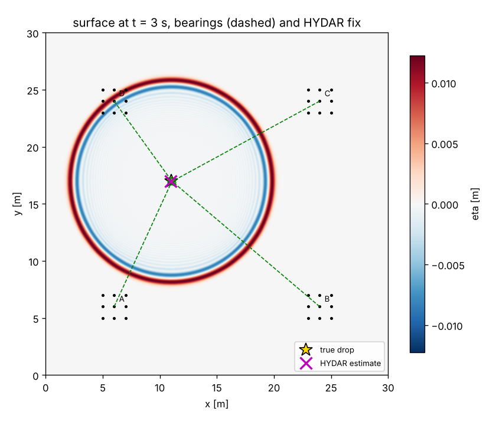
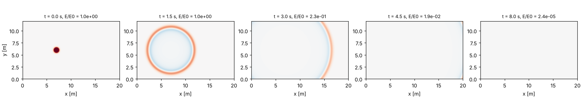
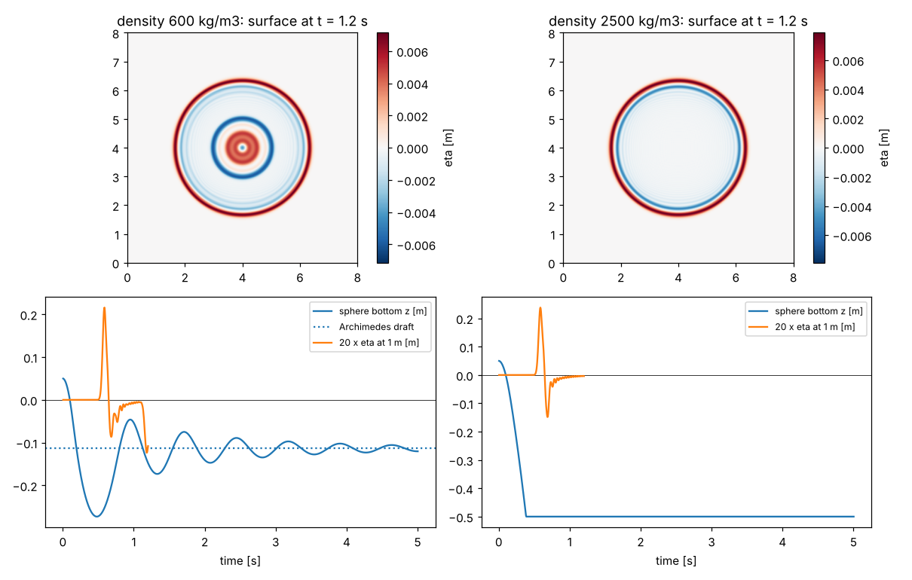
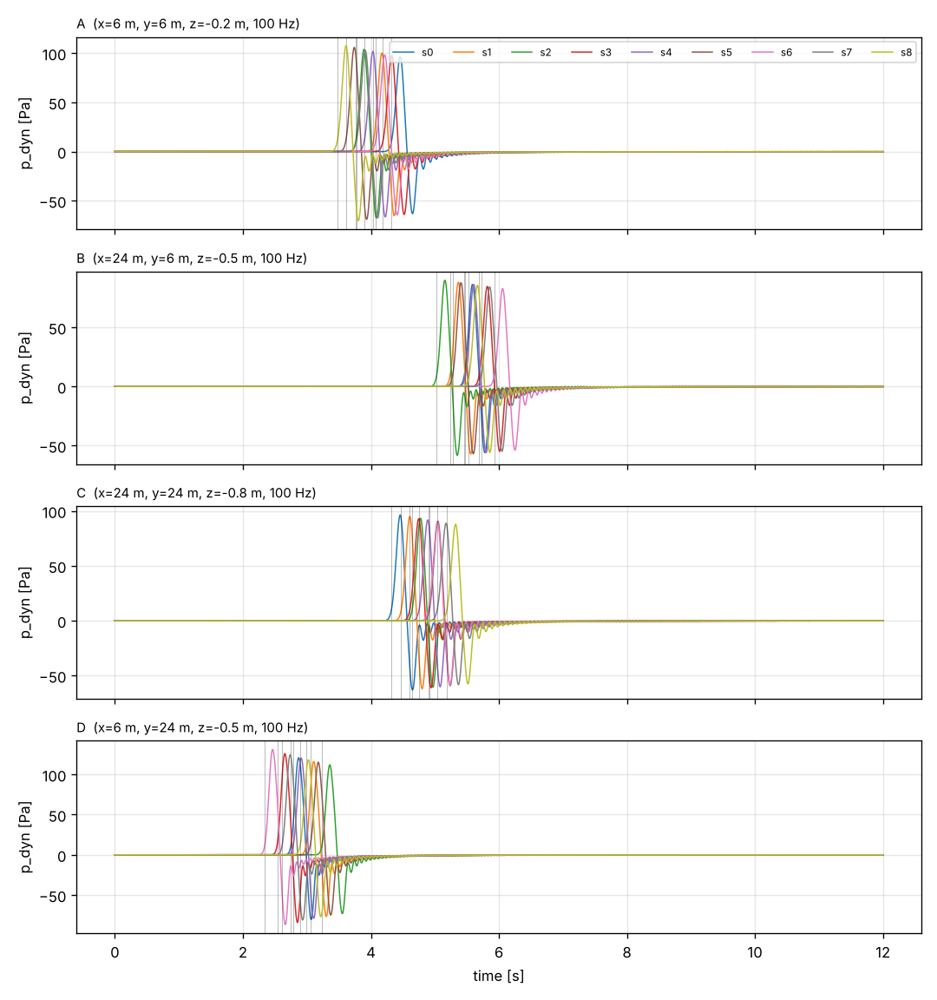

# HYDAR: Hydrodynamic Detection and Ranging

<p align="center"></p>

**HYDAR** locates an object that enters the water using the surface waves it makes. Arrays of pressure sensors record the passing waves, and the **time of flight** of the wave front gives the **direction and distance** from each array's centre to the source. It works the way radar or sonar does, except that the signal is a hydrodynamic (water-wave) disturbance rather than an electromagnetic or acoustic echo.

This repository contains a self-contained Python simulator for developing and testing HYDAR:

1. a 2D shallow-water wave solver on a large rectangular domain whose walls do not reflect,
2. a **drop object** module, where a sphere of given diameter and density is dropped at a chosen point and sinks or floats, making surface waves,
3. **pressure sensor arrays** (for example 3 × 3 sensors at 1 m spacing) placed at any x, y and depth z, sampling at 100 Hz,
4. the **HYDAR localization** step: bearing from time differences of arrival, range from time of flight, and fusion across arrays.



*A 0.5 m stone sphere is dropped at (11, 17) m. Four 3 × 3 arrays at different depths each estimate a bearing (dashed lines) and a time-of-flight range. The fused HYDAR fix lands within 4 cm of the true point.*

**Created by Jeff Tuhtan** · GitHub [@jtuhtan](https://github.com/jtuhtan) · see [Author and contact](#author-and-contact)

---

## Quick start

```bash
git clone https://github.com/jtuhtan/HYDAR-hydrodynamic-detection-and-ranging.git
cd HYDAR-hydrodynamic-detection-and-ranging
pip install -e ".[test]"

python examples/03_hydar_localization.py   # full pipeline, about 40 s
pytest                                     # 12 tests
```

```python
from hydar import Grid, Solver, DropObject, SensorArray, locate
from hydar.plotting import plot_timeseries, plot_map

# Open-water domain: 30 m x 30 m, 1 m deep, absorbing walls
sim = Solver(Grid(lx=30, ly=30, dx=0.05), depth=1.0)

# Pressure arrays: 3x3 sensors, 1 m spacing, 100 Hz, placed at (x, y, z)
arrays = [SensorArray("A", x=6,  y=6,  z=-0.2),
          SensorArray("B", x=24, y=6,  z=-0.5),
          SensorArray("C", x=24, y=24, z=-0.8)]
for a in arrays:
    sim.add(a)

# Drop a 0.5 m sphere, density 2500 kg/m^3, at (11, 17)
ball = DropObject(diameter=0.5, density=2500, x=11, y=17)
sim.add(ball)
sim.run(12.0)

# HYDAR: direction and range from each array, plus the fused position
result = locate(arrays, c=sim.c, t0=ball.t_release)   # leave out t0 if the drop time is unknown
for fix in result["fixes"]:
    print(fix)                     # bearing, range, position per array
print(result["position"])          # fused estimate

plot_timeseries(arrays, fixes=result["fixes"])   # pressure time series of every sensor
```

## Examples

| Script | What it shows |
|---|---|
| `examples/01_open_boundary.py` | A hump of water spreads out and leaves the domain. After 8 s, 2 × 10⁻⁵ of the energy is left, so the walls act as open water. |
| `examples/02_drop_sphere.py` | A floating sphere (600 kg/m³) heaves and settles at its Archimedes draft. A sinking one (2500 kg/m³) falls to the bottom. Both radiate rings of waves. |
| `examples/03_hydar_localization.py` | The full HYDAR pipeline with four arrays, both with a known drop time and with an unknown one. |
| `examples/make_hero_animation.py` | Renders the animation at the top of this page from a real simulation (needs ffmpeg, about 5 minutes). The waves, arrival times and the final fix are all computed by `hydar`; the drone and splash are decoration. |





*Pressure time series at 100 Hz from the four arrays in example 3. The thin vertical lines are the picked arrival times.*

---

## Theory

### 1. Wave model

The domain is the horizontal free surface. The unknowns are the surface elevation η(x, y, t) and the depth-averaged velocity (u, v). For still water of uniform depth h, the linear shallow-water equations are

$$
\frac{\partial \eta}{\partial t} = -h\left(\frac{\partial u}{\partial x}+\frac{\partial v}{\partial y}\right) + q(x,y,t),\qquad
\frac{\partial u}{\partial t} = -g\frac{\partial \eta}{\partial x},\qquad
\frac{\partial v}{\partial t} = -g\frac{\partial \eta}{\partial y}
$$

Waves travel at $c=\sqrt{gh}$, and $q$ is a volume source per unit area that objects use to push water aside. The equations are solved with second-order finite differences on a staggered (Arakawa C / Yee) grid with a time step $\Delta t = \mathrm{CFL}\,\Delta x / c$, using CFL = 0.5 by default.

### 2. Non-reflecting walls

The physical domain is wrapped in a split-field **perfectly matched layer** (PML; Bérenger, 1994), 40 cells thick by default. Inside the layer, η is split into $\eta_x+\eta_y$, and each part is damped only in its own direction by $\sigma(d)=\sigma_{\max}(d/L)^2$, where $\sigma_{\max} = -3c\ln R/(2L)$ and R = 10⁻⁶. Waves enter the layer without reflection and decay there, so a finite box behaves like an unbounded lake. The test suite checks that less than 10⁻⁴ of the wave energy remains after the waves have crossed the domain twice. With rigid walls, over 30 % remains.

### 3. Drop object

A sphere of diameter D and density ρₛ is released from rest at (x, y), optionally from a height above the surface and at a chosen release time. Several drops can share one simulation. The sphere moves vertically under gravity, buoyancy, added mass and quadratic drag:

$$
(m + C_a\rho_w V_{sub})\,\dot w = \rho_w g V_{sub} - m g - \tfrac12 \rho_w C_d A\, w|w|
$$

$V_{sub}$ is the spherical-cap volume below the local water level, with $C_a = 0.5$ and $C_d = 0.5$ by default. As the sphere crosses the surface, the change in submerged volume, $\dot V_{sub}$, is injected as the source q over the waterline disc. The volume of water raised in the domain therefore equals the volume the sphere displaces, which the tests verify to within 2 %. The water level around the sphere is fed back into $V_{sub}$, so a floating sphere also responds to the waves it radiates (two-way coupling). Spheres lighter than water settle at the Archimedes draft. Heavier ones sink and stop on the bottom at $z = -h + D/2$.

**Resolution.** The sphere should span at least 8 to 10 grid cells (Δx ≤ D/10 is recommended), and the code warns if it spans fewer. `recommend_grid(D, h)` suggests Δx and a domain size.

### 4. Pressure sensors

A `SensorArray` is an n_x × n_y grid of sensors (3 × 3 at 1 m by default) centred at (x, y) and mounted at depth z < 0. η is interpolated bilinearly to each sensor at every solver step and resampled at `fs` = 100 Hz. The solver step must be shorter than 1/fs, and the code checks this. Gauge pressure is the hydrostatic head plus a dynamic part:

$$
p(t) = \rho g(-z) + p_{dyn}(t)
$$

* `pressure_model="hydrostatic"` (default): $p_{dyn}=\rho g\eta$. This matches the shallow-water solver and is used for HYDAR picking.
* `pressure_model="airy"`: each frequency component is attenuated with depth by linear (Airy) wave theory, $K_p=\cosh k(h+z)/\cosh kh$ with $\omega^2 = gk\tanh kh$. It shows how strongly a deep array filters short waves. Because the filter is zero-phase, it smears sharp fronts slightly earlier in time, so do not use it for arrival picking.

### 5. HYDAR localization

Each array acts as a small sonar receiver.

1. **Arrival picking.** At each sensor, the arrival time $t_i$ is the first time $|p_{dyn}|$ exceeds a fraction (10 % by default) of the array's peak, interpolated between samples.
2. **Direction from time differences of arrival.** Across a small array the front is nearly plane, so $t_i = \tau + \mathbf{s}\cdot(\mathbf r_i-\mathbf r_c)$. A linear least-squares fit gives the slowness vector **s**, and the source lies in the direction $-\mathbf s/|\mathbf s|$ from the array centre. The fitted apparent speed $1/|\mathbf s|$ should match $c$, which serves as a quality check.
3. **Range from time of flight.** When the drop time $t_0$ is known, $r = c\,(\tau - t_0)$, as in radar ranging. Bearing and range together give a position from a single array.
4. **Fusion across arrays.** All arrival times are fitted together to a circular front, $t_i = t_0 + |\mathbf r_i - \mathbf x_s|/c$, solving for the source position $\mathbf x_s$ and, if it is unknown, $t_0$. Bearing-line intersection provides the initial guess. Because $t_0$ can be fitted, a constant picking delay cancels out, and the method also works when nobody knows when the object entered the water.

In example 3, every bearing is within 0.4° of the truth, the single-array ranges are within 0.2 m over distances of 8 to 17 m, and the fused position is within 0.05 m, whether or not the drop time is known.

---

## Assumptions and limitations

* **Shallow-water physics.** The solver is linear and non-dispersive, so it is valid for waves much longer than the depth and for amplitudes much smaller than the depth. Real waves from objects smaller than the water depth are dispersive: longer waves outrun shorter ones, and the front spreads out. A dispersive solver (Boussinesq or linear potential flow) is a natural next step, and arrival picking would then have to account for the group velocity.
* Uniform depth, flat bottom, no current, no wind waves or sensor noise.
* The sphere moves vertically only and is a source only while it crosses the surface. A fully submerged moving body does not radiate in this model.
* Sensors are ideal point gauges.

## Repository layout

```
hydar/
  solver.py     2D shallow-water solver with PML walls
  drop.py       DropObject (sphere sinks or floats, two-way coupled source)
  sensors.py    SensorArray (3x3 at 1 m, 100 Hz, x/y/z placement, depth response)
  locate.py     HYDAR: arrival picking, TDOA bearing, TOF range, multi-array fusion
  plotting.py   time-series and map plots
examples/       runnable scripts (01 to 03)
tests/          pytest suite
docs/img/       figures used in this README
```

## Author and contact

HYDAR was conceived and created by **Jeff Tuhtan**.

* GitHub: [@jtuhtan](https://github.com/jtuhtan)
* Questions, ideas and bug reports: please [open an issue](https://github.com/jtuhtan/HYDAR-hydrodynamic-detection-and-ranging/issues)

If you use HYDAR in your work, please credit the author and link to this repository.

## Reference

Bérenger, J.-P. (1994). A perfectly matched layer for the absorption of electromagnetic waves. *Journal of Computational Physics*, 114(2), 185–200.
