# HYDAR: Hydrodynamic Detection and Ranging

[](https://doi.org/10.5281/zenodo.23881055)

<p align="center">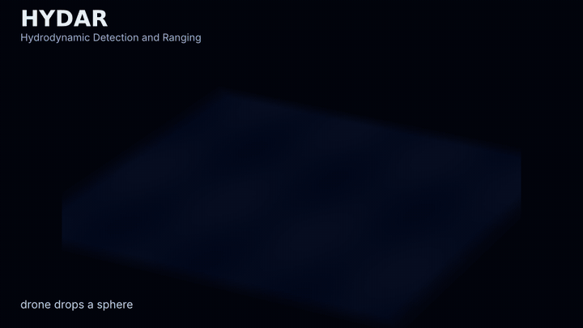</p>

**HYDAR** locates objects in water from the surface waves they make. Arrays of pressure sensors record the passing waves, and the **time of flight** of the wave front gives the **direction and distance** from each array's centre to the source. HYDAR works like radar or sonar, but its signal is a water wave rather than an electromagnetic or acoustic echo.

This repository is a self-contained Python simulator for developing and testing HYDAR. It has four parts:

1. **Wave solvers.** A 2D shallow-water solver on a large rectangular domain with non-reflecting walls, and a **dispersive** linear potential-flow solver, with the exact dispersion relation, for boat wakes.
2. **Drop objects.** A sphere of chosen diameter and density is dropped at a chosen point; it sinks or floats and makes surface waves.
3. **Pressure sensor arrays.** Arrays such as 3 × 3 sensors at 1 m spacing can be placed at any x, y and depth z, and sample at 100 Hz.
4. **HYDAR localization.** Each array estimates a bearing from time differences of arrival and a range from time of flight; the arrays' estimates are then fused.

<p align="center">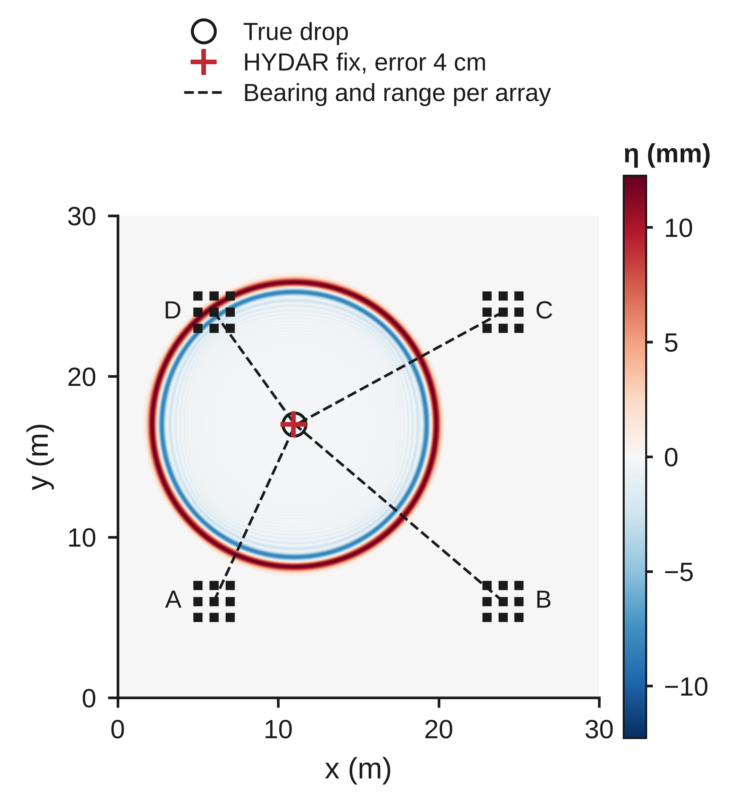</p>

*A 0.5 m stone sphere is dropped at (11, 17) m in 1 m deep water; the colours show the surface elevation η 3 s later. Four 3 × 3 arrays (A to D, 1 m spacing, at depths of 0.2 to 0.8 m) each estimate a bearing and a time-of-flight range (dashed lines). The fused HYDAR fix (red cross) lands 4 cm from the true drop point (open circle).*

**Created by Jeff Tuhtan** · GitHub [@jtuhtan](https://github.com/jtuhtan) · see [Author and contact](#author-and-contact)

---

## Quick start

```bash
git clone https://github.com/jtuhtan/HYDAR-hydrodynamic-detection-and-ranging.git
cd HYDAR-hydrodynamic-detection-and-ranging
pip install -e ".[test]"

python examples/03_hydar_localization.py   # full pipeline, about 40 s
pytest -m "not slow"                       # 36 fast tests, about 2 minutes (all 41 with plain pytest: about 5)
```

```python
from hydar import Grid, Solver, DropObject, SensorArray, locate
from hydar.plotting import plot_timeseries, plot_map

# Open-water domain: 30 m x 30 m, 1 m deep, absorbing walls
sim = Solver(Grid(lx=30, ly=30, dx=0.05), depth=1.0)

# Pressure arrays: 3x3 sensors, 1 m spacing, 100 Hz, placed at (x, y, z)
arrays = [SensorArray("A", x=6,  y=6,  z=-0.2),
          SensorArray("B", x=24, y=6,  z=-0.5),
          SensorArray("C", x=24, y=24, z=-0.8)]
for a in arrays:
    sim.add(a)

# Drop a 0.5 m sphere, density 2500 kg/m^3, at (11, 17)
ball = DropObject(diameter=0.5, density=2500, x=11, y=17)
sim.add(ball)
sim.run(12.0)

# HYDAR: direction and range from each array, plus the fused position
result = locate(arrays, c=sim.c, t0=ball.t_release)   # leave out t0 if the drop time is unknown
for fix in result["fixes"]:
    print(fix)                     # bearing, range, position per array
print(result["position"])          # fused estimate

plot_timeseries(arrays, fixes=result["fixes"])   # pressure time series of every sensor
```

## Examples

| Script | What it shows |
|---|---|
| `examples/01_open_boundary.py` | A hump of water spreads out and leaves the domain. After 8 s, only 2 × 10⁻⁵ of the energy remains, so the walls behave like open water. |
| `examples/02_drop_sphere.py` | A floating sphere (600 kg/m³) heaves and settles at its Archimedes draft. A sinking one (2500 kg/m³) falls to the bottom. Both radiate rings of waves. |
| `examples/03_hydar_localization.py` | Case study 1: the full HYDAR pipeline with four arrays, with the drop time known and unknown. |
| `examples/04_boat_tracking.py` | Case study 2: a 4.5 m Series 60 boat crosses a 120 m × 50 m domain at 3 m/s. The dispersive solver computes its Kelvin wake, and HYDAR tracks the boat from that wake (about 5 minutes). |
| `examples/05_vessel_localization.py` | Case study 3: one 3 × 3 seabed array locates a ferry 2.5 km offshore from its Kelvin wake, after Rätsep et al. (2020, 2021) (about 1 minute). |
| `examples/06_array_design.py` | Case study 4: designs the optimal 3 × 3 array for correlative interferometry, then tracks the case study 3 ferry with it, without Kelvin wake theory, and compares with the Kelvin method (about 2 minutes). |
| `examples/07_benchmark_interferometry.py` | Case study 4 benchmark: Monte Carlo comparison of interferometry and the Kelvin methods of case studies 2 and 3 for accuracy, precision and wind noise (about 30 minutes on 4 cores). Writes `docs/data/ci_benchmark.csv`. |
| `examples/08_fish_rock.py` | Case study 5: a 25 cm fish with 10 lateral-line pressure sensors finds a rock in a trapezoidal river from the rock's Kármán vortex street (about 10 s). |
| `examples/09_benchmark_fish_rock.py` | Case study 5 benchmark: 625 Monte Carlo surveys over distance, river turbulence and a wake model that differs from the fish's (about 30 minutes on 4 cores). Writes `docs/data/fish_rock_benchmark.csv`. |
| `examples/make_boat_animation.py` | Renders the case study 2 animation from a full simulation (needs ffmpeg, about 15 minutes). Blue lines mark the Kelvin cusp lines. Each red laser ends where the fitted HYDAR track places the boat when the cusp line first reaches that array. |
| `examples/make_hero_animation.py` | Renders the animation at the top of this page from a full simulation (needs ffmpeg, about 5 minutes). `hydar` computes the waves, arrival times and final fix; the drone and splash are decoration. |
| `docs/make_figures.py` | Regenerates the figures in this README (PNG at 600 dpi, plus editable PDF and SVG) in the author's paper figure style (`docs/paperfig.py`), sized for a 170 mm text width. |

## Case study 1: locating a dropped sphere

The map at the top of this page shows the result of example 3. Figures 1 and 2 check the two building blocks it relies on, the open boundaries and the drop object, and Figure 3 shows the pressure records that HYDAR analyses.

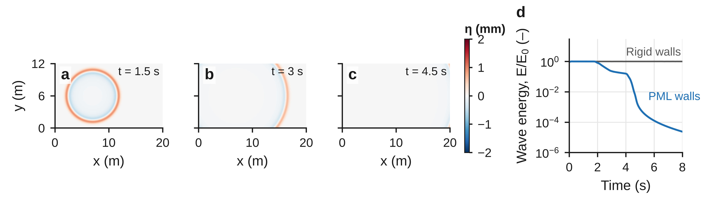

**Figure 1.** Non-reflecting walls. **a–c**, a 1 cm Gaussian hump of water in a 20 m × 12 m, 1 m deep domain spreads out and leaves through the perfectly matched layer (PML). **d**, wave energy remaining in the domain, relative to the start. It stays at 1 with rigid walls and falls below 10⁻⁴ with the PML.

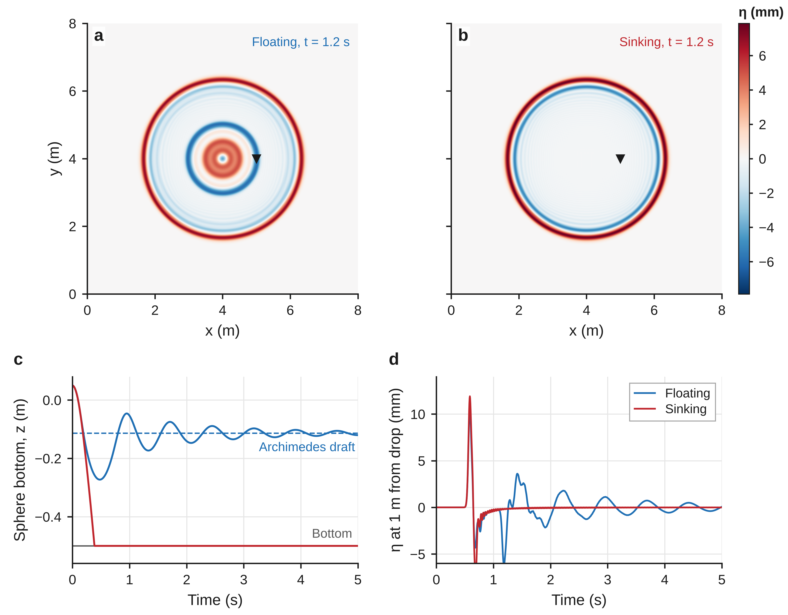

**Figure 2.** Drop objects. A 0.2 m sphere is released 5 cm above 0.5 m deep water. **a**, a floating sphere (600 kg/m³) keeps radiating rings as it bobs; **b**, a sinking sphere (2500 kg/m³) makes a single ring. **c**, height of the sphere's lowest point: the floating sphere settles at its Archimedes draft (dashed), the sinking sphere stops on the bottom. **d**, surface elevation at the wave gauge 1 m from the drop (triangle in a and b).

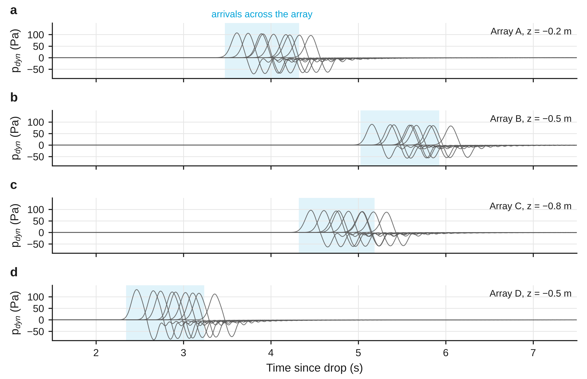

**Figure 3.** Dynamic pressure recorded at 100 Hz by the nine sensors of each array (**a–d** = arrays A–D) for the drop in the map at the top of the page. The shaded band spans the first to the last picked arrival on each array. This spread in arrival time gives the bearing; the arrival time at the array centre gives the range.

---

## Case study 2: tracking a small boat from its Kelvin wake

<p align="center">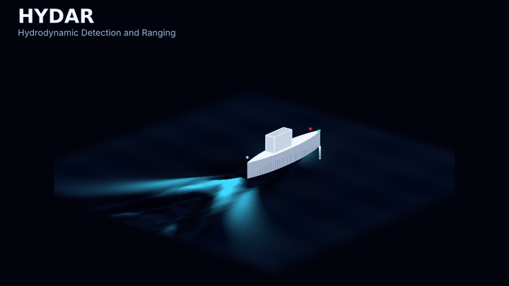</p>

A 4.5 m boat with a **Series 60** hull (beam 0.60 m, draft 0.24 m, 389 L displacement) runs at 3 m/s on a heading of 4° through 3 m deep water. Its speed is about 6 knots, a length Froude number of 0.45. Four 3 × 3 arrays, at depths of 0.3 to 0.8 m, record the dynamic pressure at their own depth at 100 Hz.

Boat waves are dispersive: long waves travel faster than short ones. Dispersion shapes the familiar **Kelvin wake**, with transverse waves behind the boat and diverging waves inside a wedge of half-angle 19.47°. The shallow-water solver cannot produce this pattern, so this case study uses `SpectralSolver`, a linear potential-flow model with the exact dispersion relation (Theory, section 1b).

HYDAR picks the moment the wake's **cusp line** passes each of the 36 sensors and fits a straight, constant-speed track to those times.

| | True | HYDAR |
|---|---|---|
| Speed | 3.00 m/s | 3.06 m/s |
| Heading | 4.0° | 3.7° |
| Distance from the hull centre at t = 20, 30, 40 s | | 0.7, 1.3, 2.0 m |
| RMS misfit of the 36 picks | | 115 ms |

```python
from hydar import Boat, Grid, SensorArray, SpectralSolver, track_boat
from hydar.boat import Series60Hull

grid = Grid(lx=120.0, ly=50.0, dx=0.125, n_pml=80)        # 10 m absorbing sponge
sim = SpectralSolver(grid, depth=3.0, dt=0.01)
arrays = [SensorArray("A", 50.0, 14.0, z=-0.3, pressure_model="solver"), ...]
for a in arrays:
    sim.add(a)
sim.add(Boat(hull=Series60Hull(length=4.5), speed=3.0, x=-8.0, y=22.0, heading_deg=4.0, ramp=4.0))
sim.run(44.0)
track = track_boat(arrays)            # Kelvin wake: speed, heading, position at t = 0
print(track.position(30.0))           # where the boat was at t = 30 s
```

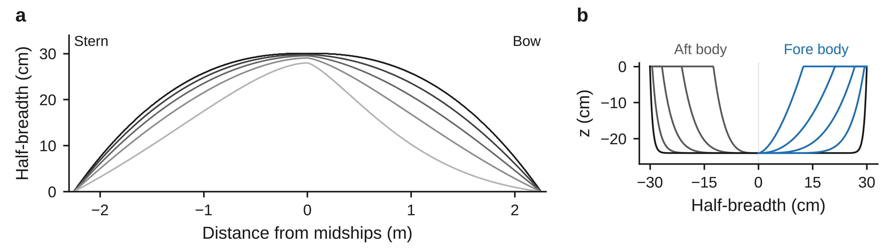

**Figure 4.** The Series 60 hull used in the boat case study, scaled to L = 4.5 m. **a**, half-breadth plan with waterlines at 0, 25, 50, 75 and 95 % of the draft (dark to light). **b**, body plan: stations 1 to 4 of the aft body on the left and stations 6 to 9 of the fore body on the right, with the midship section (black) on both sides. As built, the hull has C_B = 0.600, C_P = 0.614, C_M = 0.977, C_WP = 0.706 and its LCB 1.5 % L aft of midships.

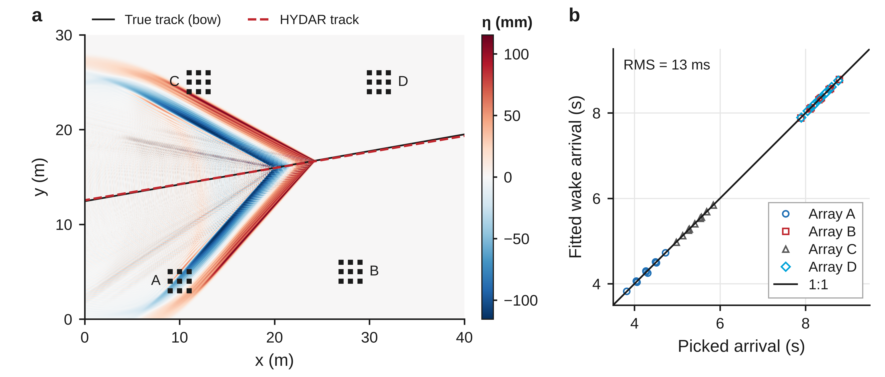

**Figure 5.** HYDAR tracking of the boat from its Kelvin wake. **a**, surface elevation 30 s after the start, computed with the dispersive solver: transverse waves behind the boat and diverging waves along the 19.47° cusp lines. The HYDAR track (dashed red) lies on the true track (black). **b**, dynamic pressure at the nine sensors of array A (0.3 m deep), with the picked cusp-line passages (red). **c**, picked cusp passages at all 36 sensors against those predicted by the fitted track; the RMS misfit is 115 ms.

**How the boat tracking works.** In deep water, two cusp lines at the Kelvin angle μ = arcsin(1/3) = 19.47° bound a boat's wake, whatever the boat's speed. The cusp line crosses a point a distance s along the track and d to the side at t = (s + d cot μ) / U = (s + 2√2 d) / U.

To time that crossing, `pick_wake` uses the shape of the wave envelope. Across a cusp line the wave amplitude follows an Airy function: it grows from zero ahead of the line, reaches Ai(0) = 0.355 on the line and peaks at 0.536 just behind it. `pick_wake` therefore band-passes each record, takes its envelope, and picks the time the envelope first reaches 0.355/0.536 = 66 % of its first maximum. A simple first-threshold pick fails for a wake, because the oscillating signal crosses any threshold on a different crest at each sensor.

`track_boat` then fits the boat's position at t = 0, its heading and its speed to the 36 picks by least squares, starting from several initial guesses. When the boat starts, it sends a weak train of long waves ahead of it. To keep these start-up waves out of the picks, the boat starts inside the absorbing layer and the arrays sit at least 50 m down the track, where the wake is fully developed.

---

## Case study 3: locating a passing ferry from its Kelvin wake

This case study follows the field work of Rätsep et al. ([2020](https://doi.org/10.1175/JTECH-D-19-0192.1), [2021](https://doi.org/10.1016/j.oceaneng.2021.109156)) in Tallinn Bay. A 3 × 3 grid of seabed pressure sensors (2.5 m spacing, 0.2 m above the bed in 3 m of water, 100 Hz) records the wakes of fast ferries passing about 3 km offshore. These ships are slower than the long-wave speed of the deep fairway, so they make a **dispersive Kelvin wake**. Simulating a domain 3 km wide with the dispersive solver of case study 2 would be very costly. Instead, the wake is synthesized from linear deep-water theory by integrating the Havelock wave spectrum numerically, which makes the cusp and both wave branches exact. A random wind sea (H_s = 0.15 m, 0.4 Hz) and sensor noise are added, and the pressure at the sensor depth follows the Airy depth response.

In the example, a ferry sails at 11 m/s (21 kn) on a course of 159°, 2.5 km from the array. The analysis uses only the recorded pressures and follows the steps of the papers:

1. **Detection.** Averaging the spectrograms of five sensors (four corners and the centre) suppresses incoherent noise ([2020](https://doi.org/10.1175/JTECH-D-19-0192.1)). The wake is flagged where its band power rises above the background.
2. **Speed, distance and time abeam from the spectrogram.** A fixed observer a distance d from the track sees two branches: transverse waves whose frequency falls towards f_t = g/(2πU), and divergent waves whose frequency rises. Both start at the cusp, at √(3/2)·f_t. Fitting the two stationary-phase branches to the spectrogram ridge gives U, d and the time the ship passed abeam. The upper divergent branch is hidden under the wind sea, as noted in the papers, so the fit uses the band below it.
3. **Wake direction from time delays.** Cross-correlating all 36 sensor pairs gives the delay of the same waves between sensors. A plane-wave fit to those delays gives the direction the cusp waves travel ([2021](https://doi.org/10.1016/j.oceaneng.2021.109156)). The delays are measured in the 30 s before the fitted cusp time. Ahead of the cusp line only the cusp wave is present; behind it the transverse and divergent branches overlap and their mean direction drifts, which would bias the course by about 1.5°.
4. **Course and position.** At the cusp, the waves travel at 35°16′ to the ship's course, so each wave direction fits two candidate courses. In the field, the coastline resolved this ambiguity. Here, the late transverse waves travel along the course, and their direction selects the correct candidate. The distance d and the side of the track the waves came from then place the ship.

| | True | HYDAR (case study 3) |
|---|---|---|
| Speed | 11.00 m/s | 10.99 m/s |
| Distance from track | 2500 m | 2403 m |
| Course | −69.0° (159° nautical) | −68.3° |
| Ship position when the cusp reaches the array | | 365 m off |

For comparison, the field study reported positions mostly within 0.5 km of the AIS positions, with about 400 m in its example case. Most of the remaining error lies along the track: the chirp fit places the ship abeam 31 s late and 4 % too close, two errors that nearly cancel in the cusp time but not in the position.

```python
from hydar import SensorArray
from hydar.kelvin import KelvinShip, record_passage, locate_vessel

array = SensorArray("H", 0, 0, z=-2.8, spacing=2.5, rotation_deg=22.5, pressure_model="airy")
ship = KelvinShip(speed=11.0, course_deg=-69.0, x0=..., y0=...)     # see examples/05
record_passage([array], ship, t_end=1800, depth=3.0, wind={"hs": 0.15, "f_peak": 0.4})
fix = locate_vessel(array)       # speed, distance, course, ship position at any time
```

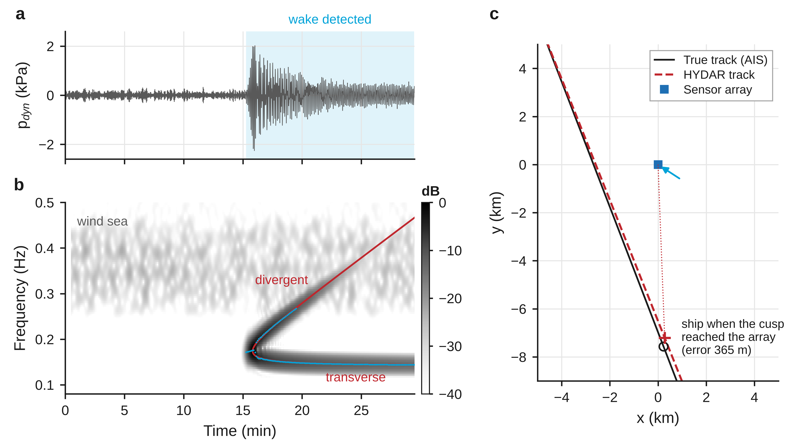

**Figure 6.** Case study 3, after Rätsep et al. (2020, 2021). **a**, dynamic pressure at the centre sensor: wind-sea noise, then the ferry wake 15 min after the ship passed abeam. **b**, spectrogram averaged over five sensors. The fitted Kelvin branches (red) follow the ridge points (cyan); the upper divergent branch disappears under the wind sea. **c**, the true track (black) and the HYDAR track (dashed red) from the single 3 × 3 array (blue). The arrow shows the measured direction of the cusp waves; the markers show the ship when the cusp reached the array, true (circle) and estimated (cross).

**Assumptions.** The model assumes deep water along the whole wave path, so it ignores refraction and shoaling as the waves enter the 3 m deep nearshore. It also represents the hull by a smooth amplitude spectrum rather than a specific ship. The spectrogram relations used here are derived in `hydar/kelvin.py` from stationary phase; the papers state the same physics in terms of the cusp and limiting transverse frequencies. The speed from the phase velocity of the cusp waves (`speed_from_phase`) is only a rough check, within about 15 %.

## Case study 4: array design and ship tracking by correlative interferometry

Case studies 2 and 3 locate a vessel with **Kelvin wake theory**: the 19.47° cusp line (case 2), and the Kelvin chirp and 35.26° cusp angle (case 3). This case study asks two questions. Can a 3 × 3 array detect and track a ship **without** that theory? And which 3 × 3 geometry does it best? The method, `hydar.interferometry`, uses only two facts that hold for the steady wave pattern of any source moving at a constant velocity **V**, in any depth:

1. **Stationarity.** A wave of the steady pattern does not move relative to the source. A wave with direction **n**, frequency ω and phase speed c(ω) from the dispersion relation therefore obeys **n · V = c**.
2. **Rays.** That wave's energy left the source when it was at **P**(t_e) = **P**₀ + **V** t_e and reached the sensor at **r** at time t travelling at the group speed c_g: **P**₀ + **V** t_e + c_g **n** (t − t_e) = **r**.

The Kelvin angle, the cusp and the chirp all follow from these two equations in deep water, but the method does not assume any of them. It also holds in finite depth and for hulls whose wake shows no clean cusp.

**How it works.**

1. **Correlative interferometry.** In sliding windows, the cross-spectra of all 36 sensor pairs are compared, frequency by frequency, with the phases a plane wave from each candidate direction would produce. This is the reference-table principle of correlative-interferometer direction finders in radio. The best match gives the wave direction **n** and a correlation ρ between 0 and 1 that measures how plane the wave field is.
2. **Detection.** A (time, frequency) cell becomes an observation when ρ ≥ 0.9 (a coherent wave crosses the array) and its power is at least 3 times the median of that frequency over the record (something transient has arrived). A stationary wind sea sits at the median and fails the second test.
3. **Tracking.** Every observation, from any number of arrays, gives one linear equation for **V** (stationarity) and, once **V** is known, one for **P**₀ (rays). A RANSAC search finds the velocity and start position that most observations agree with. The ray equation rejects wind waves, because the same wind-wave direction seen in many windows cannot come from one point on a moving source. A robust least-squares fit (Cauchy loss) then refines **P**₀ and **V**. The result is a constant-velocity track, like those of case studies 2 and 3.

**Array design.** For a plane wave of wavenumber k, the Cramér-Rao bound on the bearing is var(θ) ≥ 1 / (2 SNR k² Σᵢ ((**r**ᵢ − **r̄**) · **t**_θ)²), with **t**_θ normal to the wave direction. A wider aperture therefore measures the bearing better. But once the spacing exceeds half a wavelength, a regular grid **aliases**: its correlation pattern grows grating lobes as high as the true peak, and in noise the wrong lobe can win. `design_array` searches 3 × 3 grids whose middle column and middle row may sit anywhere between the outer ones, so the grid can be non-uniform and rectangular. It minimizes the mean bearing bound over the frequency band and all directions, subject to a highest sidelobe of 0.6, a maximum footprint and a minimum spacing (0.5 m for the ferry designs, 0.25 m for the boat design), using differential evolution.

| Case (band) | Geometry | Sensor columns, rows (m) | Footprint | Peak sidelobe | Bearing bound |
|---|---|---|---|---|---|
| Ferry (0.07 to 0.3 Hz, deep water) | Rätsep et al. grid | 2.5 m spacing | 7.1 m | none | 1 |
| | Optimal, same footprint | gaps 0.5 and 4.45; 4.55 and 0.5 | 7.1 m | 0.02 | 0.91 |
| | Optimal, 20 m footprint | gaps 3.2 and 11.1; 10.9 and 3.1 | 20 m | 0.61 | 0.34 |
| Boat (0.45 to 1.2 Hz, 3 m depth) | 1 m grid of case study 2 | 1 m spacing | 2.8 m | 1.00 (aliased above 0.9 Hz) | 1 |
| | Optimal, same footprint | gaps 1.56 and 0.46; 0.45 and 1.53 | 2.8 m | 0.60 | 0.95 |

Within the same footprint, the best grid puts the middle column and row as close to one edge as the minimum spacing allows. The design is therefore set by that constraint rather than by a trade-off: for the ferry band, a minimum spacing of 0.25, 0.5 or 1 m gives a bound of 0.89, 0.91 or 0.94 times that of the regular grid. The minimum spacing should come from the hardware or from the coherence length of the noise. The gain is small either way, 5 to 9 % here. The 1 m grid of case study 2 aliases at the short end of the boat's wake band, and the optimal grid removes that ambiguity. In the ferry case, the waves are 20 to 250 m long, so a wider footprint helps most: 20 m cuts the bearing bound to a third.

```python
from hydar import SensorArray
from hydar.interferometry import design_array, track_vessel

design = design_array(band=(0.07, 0.3), max_aperture=20.0)             # deep water by default
array = SensorArray("H", 0, 0, z=-2.8, layout=design.offsets, rotation_deg=22.5, pressure_model="airy")
# ... record a passage as in case study 3 ...
track = track_vessel([array], band=(0.07, 0.3), window=120.0, hop=20.0)
print(track.speed, track.heading_deg, track.position(600.0))
```

**Benchmark.** `examples/07_benchmark_interferometry.py` runs both earlier vessel scenarios with 100 random wind seas at each wind-sea height H_s, on every geometry, and analyses each record with both methods (2700 records, 5400 analyses). Every sensor carries 2 Pa of white noise, added after the pressure model. For the boat, the wind sea is added to the dispersive-solver pressures with the finite-depth depth attenuation (`wind_sea_head`, peak at 0.8 Hz, inside the wake band). Accuracy is the mean error (bias), precision is its standard deviation, and the track error is the RMS distance from the true track over the record. Both methods see the same record for a given seed, so geometries are also compared seed by seed (sign test and Wilcoxon signed-rank test on the track error). All rows, with the reason for every run that gave no fix, are in [`docs/data/ci_benchmark.csv`](docs/data/ci_benchmark.csv).

*Ferry (case study 3), one array 2.5 km from the track, wind sea at 0.4 Hz:*

| H_s | Method, geometry | Fixes | Speed bias ± SD (m/s) | Course bias ± SD (°) | Track RMS, median (90 %) |
|---|---|---|---|---|---|
| 0 | Kelvin, Rätsep grid | 100/100 | −0.007 ± 0.000 | +0.68 ± 0.00 | 402 m (402 m) |
| 0 | Interferometry, Rätsep grid | 100/100 | +0.004 ± 0.000 | −0.08 ± 0.00 | 68 m (82 m) |
| 0 | Interferometry, optimal 20 m | 100/100 | +0.005 ± 0.000 | −0.08 ± 0.00 | 59 m (63 m) |
| 0.3 m | Kelvin, Rätsep grid | 92/100 | −0.011 ± 0.002 | +0.63 ± 0.12 | 397 m (412 m) |
| 0.3 m | Interferometry, Rätsep grid | 100/100 | +0.001 ± 0.004 | −0.02 ± 0.09 | 131 m (334 m) |
| 0.3 m | Interferometry, optimal 20 m | 100/100 | +0.002 ± 0.003 | −0.03 ± 0.05 | 110 m (236 m) |
| 0.6 m | Kelvin, Rätsep grid | 97/100 | −0.019 ± 0.005 | +0.52 ± 0.30 | 457 m (794 m) |
| 0.6 m | Interferometry, Rätsep grid | 100/100 | −0.002 ± 0.004 | +0.04 ± 0.09 | 235 m (379 m) |
| 0.6 m | Interferometry, optimal 20 m | 100/100 | −0.000 ± 0.003 | +0.02 ± 0.07 | 205 m (308 m) |

*Boat (case study 2), four arrays 8 to 18 m from the track, wind sea at 0.8 Hz:*

| H_s | Method, geometry | Fixes | Speed bias ± SD (m/s) | Course bias ± SD (°) | Track RMS, median (90 %) |
|---|---|---|---|---|---|
| 0 | Kelvin, 1 m grid | 100/100 | +0.064 ± 0.001 | −0.28 ± 0.00 | 1.40 m (1.40 m) |
| 0 | Interferometry, 1 m grid | 100/100 | +0.033 ± 0.000 | +0.41 ± 0.01 | 0.73 m (0.73 m) |
| 0 | Interferometry, optimal | 100/100 | +0.025 ± 0.000 | +0.52 ± 0.01 | 0.99 m (0.99 m) |
| 0.025 m | Kelvin, 1 m grid | 100/100 | +0.064 ± 0.013 | −0.28 ± 0.08 | 1.42 m (1.48 m) |
| 0.025 m | Interferometry, 1 m grid | 100/100 | +0.025 ± 0.011 | +0.43 ± 0.38 | 0.74 m (1.17 m) |
| 0.025 m | Interferometry, optimal | 100/100 | +0.017 ± 0.013 | +0.63 ± 0.42 | 0.64 m (1.09 m) |
| 0.05 m | Kelvin, 1 m grid | 100/100 | +0.065 ± 0.028 | −0.27 ± 0.21 | 1.46 m (1.64 m) |
| 0.05 m | Interferometry, 1 m grid | 100/100 | +0.017 ± 0.024 | +0.63 ± 1.07 | 1.33 m (2.15 m) |
| 0.05 m | Interferometry, optimal | 100/100 | +0.015 ± 0.028 | +0.86 ± 0.92 | 1.25 m (2.07 m) |
| 0.1 m | Kelvin, 1 m grid | 100/100 | +0.76 ± 2.06 | +26.1 ± 61.1 | 45 m (88 m) |
| 0.1 m | Interferometry, 1 m grid | 79/100 | +0.16 ± 0.92 | +5.1 ± 13.8 | 3.3 m (144 m) |
| 0.1 m | Interferometry, optimal | 88/100 | +0.00 ± 0.22 | +2.5 ± 13.1 | 2.9 m (57 m) |

**What the benchmark shows.**

* **Ferry: interferometry is more accurate in every wind, by a factor that shrinks as the wind rises.** The Kelvin method of case study 3 carries a course bias of +0.5 to +0.7° and a track error of about 400 m, which comes from its chirp fit (see case study 3) and hardly changes up to H_s = 0.45 m. Interferometry has a course bias below 0.1° and a speed bias of 0.005 m/s or less. Its median track error is 5.9 times smaller in calm water, 3.0 times at H_s = 0.3 m and 1.9 times at 0.6 m, because its error grows with the wind while the Kelvin error is dominated by the fixed bias. The run-to-run spread of the course is similar for both methods up to H_s = 0.3 m (0.1°); above that the Kelvin spread is three times larger. Interferometry returned a fix in all 1500 runs. The Kelvin method gave none in 52 of 1500 (19 of 500 on the Rätsep grid): in each, the chirp fit put the analysis window outside the record.
* **Boat: interferometry is more accurate in calm water and light wind, less precise in moderate wind.** Up to H_s = 0.025 m it halves the track error and the speed bias. Its course, however, carries a bias of +0.4 to +0.6°, against −0.28° for the cusp-line method, and a larger spread. At H_s = 0.05 m the median track errors are close (1.33 m against 1.46 m), but the cusp-line method is more precise: course spread 0.21° against 1.07°, and a 90th percentile of 1.64 m against 2.15 m. The boat's wake lasts only a few seconds at each array and overlaps the wind sea in frequency, so the four arrays together yield only about 60 coherent observations, while the cusp-line pick averages the envelope over the whole wake band. At H_s = 0.1 m the cusp-line method returns a track every time, but with a median error of 45 m. Interferometry returns a track in 79 of 100 runs, most of them good (median 3.3 m) and some far off (90th percentile 144 m). Above that both fail, and interferometry mostly says so: it returns no track in 361 of 1200 runs, nearly all for lack of coherent observations.
* **Geometry, compared seed by seed.** For the ferry, the optimal 20 m array beats the Rätsep grid in 93 of 100 calm runs and in 242 of 400 runs with wind (sign test and Wilcoxon p < 0.001). The median gain is 9 m in calm water and 15 to 46 m in wind, 13 to 28 % of the median error and 19 to 33 % of the 90th percentile. At a single wind height the gain is not always significant (57 of 100 at H_s = 0.6 m). The optimal array with the same footprint helps in calm water (48 m against 68 m, all 100 runs) and at H_s = 0.6 m (65 of 100), but not in between; over all runs with wind it wins 211 of 400, which is no better than chance (p = 0.29). For the boat, the optimal grid is worse than the 1 m grid in calm water (0.99 m against 0.73 m, all 100 runs), better in light wind (67 of 100 at H_s = 0.025 m, p = 0.001), and not significantly different at 0.05 m and 0.1 m, although it returns more fixes at 0.1 m (88 against 79) with a smaller 90th percentile.

So the claim holds for the ferry and does not hold in general for the boat. In the ferry case, interferometry is 2 to 6 times more accurate than the Kelvin method and never fails to give a fix, and a wider optimized array adds a further 13 to 28 %. Part of the Kelvin error is a bias of its chirp fit that a better fit could remove, so the factor says more about this implementation than about Kelvin theory. Optimizing the geometry inside the same footprint gives little. In the boat case, interferometry is more accurate in calm water and light wind, but in moderate wind the cusp-line method is more precise.

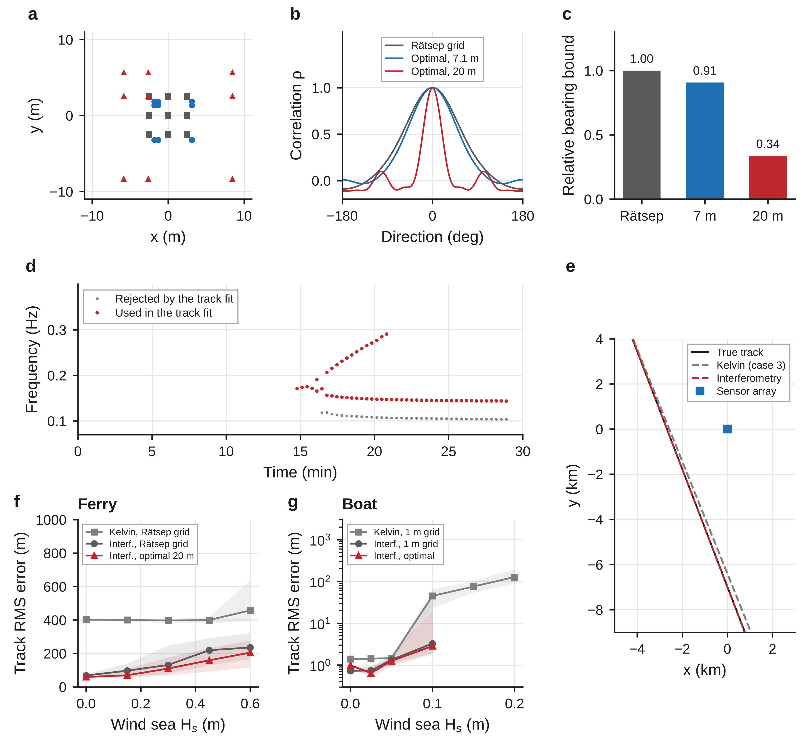

**Figure 7.** Case study 4. **a**, the Rätsep et al. grid (grey squares) and the optimal 3 × 3 grids for the ferry band with the same 7.1 m footprint (blue) and a 20 m footprint (red). **b**, their correlation patterns at 0.3 Hz for a wave from 0°: the wide grid has a narrow main lobe and low sidelobes. **c**, their bearing Cramér-Rao bounds relative to the Rätsep grid. **d**, the interferometric observations of one ferry passage (optimal 20 m grid, wind sea H_s = 0.3 m): the transverse branch, the divergent branch and the cusp emerge from direction finding alone, without a Kelvin model. The grey cells are spectral-leakage sidelobes of the strong transverse peak, rejected because they do not fit a single moving source. **e**, the true track, the Kelvin track of case study 3 and the interferometry track, from the same record. **f**, **g**, median track error (shading: 25th to 75th percentile, 100 runs) against wind-sea height for the ferry and the boat. A point is missing where fewer than half the runs gave a fix.

**Assumptions.** The ferry wake is synthesized with deep-water dispersion (as in case study 3), so the interferometry uses deep-water dispersion there too; the boat case uses the 3 m depth of the solver. Both methods assume a straight track at constant speed. The wind sea is linear, so it is added to the recorded wake. The plane-wave model needs the aperture to be small compared with the distance to the track, which limits how wide an array can usefully be for near targets. The analysis windows (120 s for the ferry, 6 s for the boat) are chosen per scenario; for the boat, where the source moves 18 m in one window, each cell is dated by the power-weighted time of its wave group (`time_stamp="centroid"`) rather than the window centre.

---

## Case study 5: a fish finds a rock from its Kármán vortex street

Case studies 1 to 4 locate a source from the **waves** it radiates. A rock in a river radiates almost nothing, but the current sheds a **Kármán vortex street** from it, and the street is carried downstream past anything that waits there. Trout hold station in such streets and time their swimming to them (Liao et al. 2003). This case study asks whether a fish-sized body with a lateral line of pressure sensors can find the rock from that street alone. HYDAR's time of flight becomes a **time of convection**: the street arrives at the fish's head before its mid-body, which says the source is upstream and how fast the street travels.

**Scenario** (`examples/08_fish_rock.py`, `hydar.karman`). The values the request did not fix are assumptions, chosen for a small gravel-bed river:

| Part | Value |
|---|---|
| River | Straight, trapezoidal: 4 m flat bed, 1 : 2 banks, 0.25 m deep on the bed (5 m wide at the surface), bed slope 0.002, Manning n 0.035. Manning's equation (Chow 1959) gives 0.47 m/s mean velocity, 0.52 m³/s, Froude number 0.31 |
| Rock | Hemisphere resting on the bed, **half of its height above the water**: radius 0.50 m (twice the depth), 0.87 m wide at the waterline. Its depth-averaged diameter D = 0.96 m sets the shedding |
| Street | Strouhal number St = 0.2 (Williamson 1996), so f = St U / D = 0.10 Hz at U = 0.48 m/s; convection speed U_c = 0.88 U = 0.42 m/s; like vortices 4.2 m apart, rows 1.18 m apart (von Kármán's ratio 0.281, von Kármán 1911); circulation 0.68 m²/s from the self-induced speed of the street; Reynolds number 4.6 × 10⁵; shallow-wake stability number 0.04, well inside the vortex-street regime (Chen & Jirka 1995) |
| Fish | 25 cm long, head upstream, at mid-depth. **10 pressure sensors** on one line along the body: 5 evenly spread over the head third (0.8 to 7.5 cm from the snout) and 5 over the middle third (9.2 to 15.8 cm), 1.67 cm apart. The tail third has no sensors |
| Noise | 2 Pa white noise per sensor (as in case study 4) and river turbulence: a frozen random pressure field carried at U, with an RMS of ρ (Tu U)² and an f^(−7/3) inertial range; Tu = 10 % gives 2.3 Pa |

**The street model.** Vortices form 1.5 D behind the rock and drift downstream in two rows. Each is a Lamb-Oseen vortex whose core grows by turbulent diffusion (eddy viscosity ν_t = 0.01 U D) and whose circulation decays by bed friction (rate c_f U / h, with c_f = g n² / h^(1/3)). The banks are reflecting walls (method of images). The pressure is the unsteady Bernoulli pressure of the moving pattern, with each vortex's own pressure taken from its cyclostrophic balance inside the core. The vortices are prescribed, not computed: this is a kinematic model of a street, not a flow simulation.

**How the fish finds the rock.** The fish holds station at 19 positions across the river, 0.2 m apart, for 60 s each (19 minutes), at a fixed distance behind the rock.

1. **Detection and frequency.** The averaged spectrum shows a line at f and its harmonic 2f.
2. **Convection speed and direction.** At each station, the phase of f and 2f falls linearly from head to mid-body. The slope gives U_c, and its sign says the street comes from upstream. The 15 cm of the sensor line see a phase difference of only 13° at f, which is enough at these signal levels.
3. **Size.** With assumed St and U_c / U, the stream speed is U = U_c / 0.88 and the rock's shedding diameter is D = St U / f.
4. **Lateral position.** The amplitude of f peaks near each vortex row and vanishes on the street's centreline, where only 2f is left. The rock lies on the centreline of this mirror-symmetric pattern.
5. **Distance.** As the street ages, its cores grow and its circulation decays, so the lateral profiles get lower and wider with distance. Fitting the model's profiles (with D, U and U_c from steps 2 and 3) to the measured ones gives the distance and refines the lateral position. The strongest spectral line could be 2f rather than f; both readings are fitted and the one that matches better is kept, provided its line at f stands out of the noise.

Steps 1 to 4 use only the frequency, the phase and the mirror symmetry of the street. Step 5 needs a model of how the street ages, and the benchmark shows how much the answer depends on it.

In example 8 (rock at y = 0.4 m, fish 6 m behind it, 10 % turbulence), the fish estimates f within 0.2 %, U_c within 1.4 %, D within 1.4 %, the distance as 5.99 m (true 6.00 m) and the lateral position as 0.39 m (true 0.40 m).

```python
from hydar.karman import (HemisphereRock, KarmanStreet, RiverTurbulence, TrapezoidalChannel,
                          lateral_survey, locate_rock)

river = TrapezoidalChannel(bed_width=4.0, side_slope=2.0, depth=0.25, slope=0.002, manning_n=0.035)
rock = HemisphereRock.from_protrusion(river, x=0.0, y=0.4, protrusion=0.5)
street = KarmanStreet(river, rock)
survey = lateral_survey(street, x_snout=5.92, ys=[-1.8 + 0.2 * i for i in range(19)],
                        turbulence=RiverTurbulence(street.U, intensity=0.1))
fix = locate_rock(survey)
print(fix.x, fix.y, fix.diameter)
```

**Benchmark.** `examples/09_benchmark_fish_rock.py` repeats the survey with 25 seeds per setting: a random lateral rock position (|y| ≤ 0.8 m), shedding phase, turbulence and sensor noise. It reports the lateral error, the distance error and the error of D. Results are in [`docs/data/fish_rock_benchmark.csv`](docs/data/fish_rock_benchmark.csv).

*The fish's wake model equals the true one; rows differ in distance and river turbulence (Tu):*

| Distance | Tu | Detected | Lateral error, median (90 %) | Distance error, median | Distance error, median abs. (90 %) | D error, mean ± SD |
|---|---|---|---|---|---|---|
| 3 m | 0 | 25/25 | 0.02 m (0.04 m) | +0.38 m | 0.38 m (0.41 m) | +29 ± 1 % |
| 3 m | 10 % | 25/25 | 0.04 m (0.09 m) | +0.37 m | 0.37 m (10.7 m) | +27 ± 3 % |
| 3 m | 15 % | 25/25 | 0.08 m (0.17 m) | +0.34 m | 0.34 m (8.5 m) | +23 ± 5 % |
| 6 m | 0 | 25/25 | 0.01 m (0.01 m) | −0.16 m | 0.16 m (0.30 m) | +0.3 ± 0.7 % |
| 6 m | 10 % | 25/25 | 0.01 m (0.02 m) | −0.04 m | 0.13 m (0.23 m) | +1.1 ± 0.8 % |
| 6 m | 15 % | 25/25 | 0.02 m (0.06 m) | +0.25 m | 0.28 m (0.68 m) | +3.2 ± 1.1 % |
| 9 m | 0 | 25/25 | 0.00 m (0.01 m) | −0.12 m | 0.15 m (0.35 m) | +0.8 ± 1.1 % |
| 9 m | 10 % | 25/25 | 0.03 m (0.07 m) | +0.29 m | 0.29 m (0.56 m) | +3.0 ± 1.4 % |
| 9 m | 15 % | 20/25 | 0.13 m (0.61 m) | +0.49 m | 0.92 m (6.1 m) | +7.7 ± 2.5 % |
| 12 m | 0 | 25/25 | 0.00 m (0.02 m) | −0.03 m | 0.50 m (1.6 m) | +2.0 ± 3.9 % |
| 12 m | 10 % | 22/25 | 0.09 m (0.17 m) | +1.51 m | 1.56 m (2.8 m) | +7.9 ± 4.0 % |
| 12 m | 15 % | 13/25 | 0.46 m (1.46 m) | −8.88 m | 8.88 m (9.5 m) | +95 ± 178 % |

The rows for Tu = 5 % lie between those for 0 and 10 % and are in the CSV file.

*The true wake differs from the fish's model (6 m behind the rock, Tu = 10 %):*

| True wake | Detected | Lateral error, median (90 %) | Distance error, median | D error, mean ± SD |
|---|---|---|---|---|
| Same as the model | 25/25 | 0.01 m (0.02 m) | −0.04 m | +1.1 ± 0.8 % |
| Strouhal number 0.17 (model 0.2) | 25/25 | 0.01 m (0.03 m) | +0.45 m | +21 ± 1 % |
| Strouhal number 0.23 | 25/25 | 0.01 m (0.03 m) | −0.22 m | −12 ± 1 % |
| U_c / U = 0.80 (model 0.88) | 25/25 | 0.01 m (0.01 m) | −1.88 m | −8.7 ± 0.3 % |
| U_c / U = 0.95 | 21/25 | 0.26 m (1.77 m) | −3.43 m | +13 ± 6 % |
| Eddy viscosity of the cores × 0.5 | 25/25 | 0.01 m (0.01 m) | −1.61 m | +0.3 ± 0.4 % |
| Eddy viscosity × 2 | 25/25 | 0.02 m (0.05 m) | +2.20 m | +2.9 ± 1.6 % |
| Bed roughness n = 0.025 (model 0.035) | 25/25 | 0.01 m (0.01 m) | −1.32 m | +0.8 ± 0.4 % |
| Bed roughness n = 0.050 | 25/25 | 0.04 m (0.06 m) | +2.83 m | +4.3 ± 3.8 % |

**What the benchmark shows.**

* **The lateral position is robust.** It comes from the mirror symmetry of the street, so it needs no wake model. The median error is 1 to 4 cm up to 9 m behind the rock in turbulence up to 10 %, and stays at 4 cm or less whatever the wake model gets wrong, except when the street is so weak that it is barely detected (U_c / U = 0.95 gives a circulation of less than half the nominal one).
* **The rock's size is right only once the street has formed.** From 6 to 9 m behind the rock, D is within 1 to 3 % in turbulence up to 10 %. At 3 m (3 D), D comes out 23 to 29 % too large in every run: the vortices are still gaining strength there, so the phase along the body travels faster than the convection speed the fish assumes. D also carries any error of the assumed Strouhal number one for one (+21 % for St = 0.17).
* **The distance is accurate when the model is right, and only as good as the model otherwise.** With the true wake model, the median distance error is 0.13 to 0.29 m at 6 to 9 m in turbulence up to 10 %. At 3 m it is 0.4 m, with a few runs off by 8 to 11 m in turbulence, where the misfit has a second minimum far downstream. Detection fades with distance and turbulence: at 12 m in 15 % turbulence the street was detected in 13 of 25 runs, and those fixes are poor. When the wake ages differently from the model, the distance is biased by 1.3 to 2.8 m (eddy viscosity halved or doubled, bed roughness 0.025 or 0.05, convection ratio 0.80). This is the price of ranging from the street's ageing: the fish needs to know how fast the cores grow and how strongly the bed damps them.

So the fish finds the line the rock sits on (the streamline through it) to a few centimetres, and how big the rock is to a few per cent once it is more than about 5 D downstream. How far upstream the rock is depends on the wake model: it is right to 0.1 to 0.3 m when the model is right, and off by up to 3 m when the eddy viscosity or the bed roughness is wrong by a factor of 1.5 to 2. A fish that swims upstream along the found line would remove that dependence; the model does not include it.

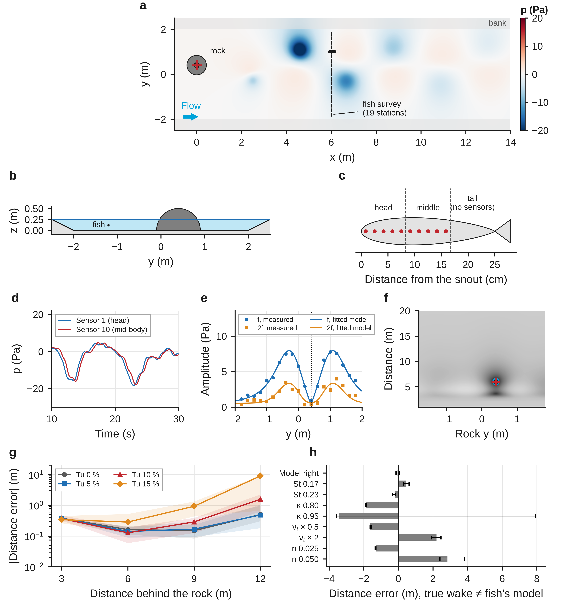

**Figure 8.** Case study 5. **a**, plan view of the river with a snapshot of the street's pressure (banks shaded). The rock (grey, open circle at its centre) sheds the street; the fish (black bar) surveys 19 stations across the river 6 m downstream. The red cross is the fish's estimate of the rock. **b**, cross section: trapezoidal channel and the hemisphere, half above the water. **c**, the fish and its 10 sensors: 5 on the head third, 5 on the middle third, none on the tail third. **d**, pressure at the head and mid-body sensors at the station with the strongest street (low-passed at 1 Hz for display): the mid-body trace lags by the convection time. **e**, amplitude of f and 2f across the river, measured and fitted; the dotted line is the true rock position. **f**, fit misfit over the rock's lateral position and distance (dark is better); open circle: truth, cross: estimate. **g**, median absolute distance error against distance for four turbulence intensities (shading: 25th to 75th percentile, 25 runs); a point is missing where fewer than half the runs detected the street. **h**, median distance error (bars: 25th to 75th percentile) when the true wake differs from the model the fish assumes, 6 m behind the rock in 10 % turbulence.

**Assumptions.** The vortex street is kinematic: positions, strengths and core sizes follow prescribed laws (Strouhal number, convection ratio, von Kármán spacing and circulation, Lamb-Oseen cores with an eddy viscosity, bed-friction decay) rather than a flow solution. The tapering hemisphere is assumed to shed one frequency set by its depth-averaged diameter; real tapered bodies can shed in cells at several frequencies. The Reynolds number (4.6 × 10⁵) is near the drag crisis of a smooth cylinder; St = 0.2 is assumed for a rough rock in turbulent flow, and the benchmark tests 0.17 and 0.23. The flow is uniform across the street (the stream velocity at the rock), the banks are vertical walls at the waterline, and the rock's own surface waves (Froude number 0.31) are left out. The fish is a passive probe: its body, its swimming and its own flow do not disturb the pressure, and it moves between stations instantly. The turbulence is frozen and has the same statistics everywhere.

---

## Theory

### 1. Wave model

The domain is the horizontal free surface. The unknowns are the surface elevation η(x, y, t) and the depth-averaged velocity (u, v). For still water of uniform depth h, the linear shallow-water equations are

$$
\frac{\partial \eta}{\partial t} = -h\left(\frac{\partial u}{\partial x}+\frac{\partial v}{\partial y}\right) + q(x,y,t),\qquad
\frac{\partial u}{\partial t} = -g\frac{\partial \eta}{\partial x},\qquad
\frac{\partial v}{\partial t} = -g\frac{\partial \eta}{\partial y}
$$

Waves travel at $c=\sqrt{gh}$, and $q$ is a volume source per unit area through which objects push water aside. The solver uses second-order finite differences on a staggered (Arakawa C / Yee) grid, with a time step $\Delta t = \mathrm{CFL}\,\Delta x / c$ and CFL = 0.5 by default.

### 1b. Dispersive solver (boat wakes)

`SpectralSolver` keeps the full linear free-surface physics for inviscid, irrotational flow. In Fourier space, every wavenumber k of the surface elevation $\hat\eta$ and of the surface velocity potential $\hat\phi$ is a harmonic oscillator,

$$
\frac{\partial \hat\eta}{\partial t} = k\tanh(kh)\,\hat\phi,\qquad
\frac{\partial \hat\phi}{\partial t} = -g\,\hat\eta - \frac{\hat P}{\rho},
$$

with the exact dispersion relation $\omega^2 = gk\tanh(kh)$, valid from shallow to deep water. The solver advances each oscillator exactly over a time step, holding the applied surface pressure P at its mid-step value. It therefore has no stability limit and no numerical dispersion.

The boat enters as the classical **pressure patch** of linear ship-wave theory (Wehausen and Laitone, 1960), $P=\rho g D(x,y,t)$, where D is the hull draft. Sensors with `pressure_model="solver"` read the dynamic pressure at their own depth directly, $p_{dyn}/(\rho g)=\mathcal F^{-1}[(\hat\eta+\hat P/\rho g)\cosh k(h+z)/\cosh kh]$.

Because the FFT makes the domain periodic, the walls are a **sponge layer** that damps η and φ by $e^{-\sigma\Delta t}$, with σ growing quadratically to 3 s⁻¹ at the edge. Tests check the standing-wave frequency against the dispersion relation, and check that less than 10⁻³ of the wave energy remains once the waves have left the domain.

### 2. Non-reflecting walls

The physical domain is wrapped in a split-field **perfectly matched layer** (PML; Bérenger, 1994), 40 cells thick by default. Inside the layer, η is split into $\eta_x+\eta_y$, and each part is damped only in its own direction by $\sigma(d)=\sigma_{\max}(d/L)^2$, where $\sigma_{\max} = -3c\ln R/(2L)$ and R = 10⁻⁶. Waves enter the layer without reflection and decay there, so a finite box behaves like an unbounded lake. The test suite checks that less than 10⁻⁴ of the wave energy remains after the waves have crossed the domain twice. With rigid walls, over 30 % remains.

### 3. Drop object

A sphere of diameter D and density ρₛ is released from rest at (x, y), optionally from a height above the surface and at a chosen release time. Several drops can share one simulation. The sphere moves vertically under gravity, buoyancy, added mass and quadratic drag:

$$
(m + C_a\rho_w V_{sub})\,\dot w = \rho_w g V_{sub} - m g - \tfrac12 \rho_w C_d A\, w|w|
$$

Here $V_{sub}$ is the spherical-cap volume below the local water level, and $C_a = 0.5$ and $C_d = 0.5$ by default. As the sphere crosses the surface, the rate of change of submerged volume, $\dot V_{sub}$, enters as the source q over the waterline disc. The volume of water raised in the domain therefore equals the volume the sphere displaces; the tests verify this to within 2 %. The water level around the sphere is fed back into $V_{sub}$, so a floating sphere also responds to the waves it radiates (two-way coupling). Spheres lighter than water settle at the Archimedes draft. Heavier ones sink and stop on the bottom at $z = -h + D/2$.

**Resolution.** The sphere should span at least 8 to 10 grid cells (Δx ≤ D/10 is recommended), and the code warns if it spans fewer. `recommend_grid(D, h)` suggests Δx and a domain size.

### 4. Pressure sensors

A `SensorArray` is an n_x × n_y grid of sensors (3 × 3 at 1 m by default) centred at (x, y) and mounted at depth z < 0. η is interpolated bilinearly to each sensor at every solver step and resampled at `fs` = 100 Hz. The solver step must be shorter than 1/fs, and the code checks this. Gauge pressure is the hydrostatic head plus a dynamic part:

$$
p(t) = \rho g(-z) + p_{dyn}(t)
$$

* `pressure_model="hydrostatic"` (default): $p_{dyn}=\rho g\eta$. This matches the shallow-water solver and is used for HYDAR picking.
* `pressure_model="airy"`: linear (Airy) wave theory attenuates each frequency component with depth, $K_p=\cosh k(h+z)/\cosh kh$ with $\omega^2 = gk\tanh kh$. This model shows how strongly a deep array filters short waves. Because the filter is zero-phase, it smears sharp fronts slightly earlier in time, so do not use it for arrival picking.
* `pressure_model="solver"`: the dispersive `SpectralSolver` supplies the dynamic pressure at the sensor depth directly (section 1b). Case study 2 uses this model.

`noise_pa` adds white sensor noise (standard deviation in Pa) to the dynamic pressure after the pressure model, so the water above the sensor does not filter it. Case studies 3 and 4 use 2 Pa.

### 5. Boat

`Boat` moves a hull along a straight line at constant speed. In the dispersive `SpectralSolver`, the hull's depth below the waterline, D(x, y, t), acts as the surface pressure head P/(ρg) (section 1b). In the shallow-water `Solver`, its rate of change q = ∂D/∂t enters as the volume source instead. This source pushes water out ahead of the bow and lets it flow back behind the stern. It integrates to zero, and the water raised around the hull equals the displaced volume (tested to within 3 %). In both solvers, the boat can start inside the absorbing layer so that it enters the domain already at speed.

The default `Series60Hull` follows the Series 60 parent form (Todd, 1963): L/B = 7.5, B/T = 2.5, C_B = 0.60, C_P = 0.614, C_M = 0.977, C_WP = 0.706, LCB 1.5 % L aft. Rather than reproduce the published offset table, the code fits smooth curves to exactly these coefficients:

* the sectional-area curve $A(\xi)=A_M(1-|\xi|^{n})$, with separate fore and aft exponents that set C_P and the LCB;
* the waterline $b(\xi)=\tfrac{B}{2}(1-|\xi|^{m})$, with m set by C_WP;
* section depth profiles $D = T\,(1-|y/b|^{k})$, with k chosen to give each section its area.

The principal dimensions, displacement, prismatic distribution and LCB therefore match Series 60, while the detailed section shapes are approximate. `Series60Hull.coefficients()` reports the values achieved, and a test checks them to ±0.003. An `EllipseHull` is also available.

### 6. HYDAR localization

Each array acts as a small sonar receiver. For a drop, HYDAR works in four steps.

1. **Arrival picking.** At each sensor, the arrival time $t_i$ is the first time $|p_{dyn}|$ exceeds a fraction (10 % by default) of the array's peak, interpolated between samples.
2. **Direction from time differences of arrival.** Across a small array the front is nearly plane, so $t_i = \tau + \mathbf{s}\cdot(\mathbf r_i-\mathbf r_c)$. A linear least-squares fit gives the slowness vector **s**, and the source lies in the direction $-\mathbf s/|\mathbf s|$ from the array centre. The fitted apparent speed $1/|\mathbf s|$ should match $c$, which serves as a quality check.
3. **Range from time of flight.** When the drop time $t_0$ is known, $r = c\,(\tau - t_0)$, as in radar ranging. Bearing and range together give a position from a single array.
4. **Fusion across arrays.** A circular front, $t_i = t_0 + |\mathbf r_i - \mathbf x_s|/c$, is fitted to all arrival times together, solving for the source position $\mathbf x_s$ and, if it is unknown, $t_0$. The intersection of the bearing lines provides the initial guess. Because $t_0$ can be fitted, a constant picking delay cancels out, and the method also works when the time the object entered the water is unknown.

In example 3, every bearing is within 0.4° of the truth, the single-array ranges are within 0.2 m over distances of 8 to 17 m, and the fused position is within 0.05 m, whether or not the drop time is known. A moving boat needs a different model of the wave front; case study 2 describes it.

---

## Assumptions and limitations

* **Shallow-water physics (drop case).** The drop examples use the shallow-water `Solver`. Because it is linear and non-dispersive, it is valid only for waves much longer than the depth and for amplitudes much smaller than the depth. Real waves from objects smaller than the water depth are dispersive: longer waves outrun shorter ones, and the front spreads out. The dispersive `SpectralSolver` is forced by surface pressure only and does not yet take the sphere's volume source, so adding a `DropObject` to it raises an error. Arrival picking would also have to account for the group velocity.
* **Idealized water.** The depth is uniform and the bottom flat. Case studies 1 and 2 have no current, wind waves or sensor noise; case study 3 adds wind sea and noise.
* **Sphere motion.** The sphere moves only vertically, and it is a wave source only while it crosses the surface. A fully submerged moving body does not radiate in this model.
* **Sensors.** All sensors are ideal point gauges.
* **Interferometry (case study 4).** The tracker assumes plane waves across each array, a straight track at constant speed and a known dispersion relation (deep water or a given depth). Its benefit over the Kelvin methods depends on the scenario; see the benchmark in case study 4.
* **Vortex street (case study 5).** The street is kinematic, not computed: vortex positions, strengths and core growth follow prescribed laws, and the fish is a passive probe that does not disturb the flow. Its distance estimate depends on how the street ages (core growth and bed friction), which the fish has to assume; see the benchmark in case study 5.
* **Boats.** The dispersive solver of case study 2 produces the Kelvin wake, but it is still linear. The hull is a pressure patch rather than a body boundary, and the model leaves out wave breaking and nonlinear steepening near the hull. The tracking fit assumes a straight track at constant speed and the deep-water Kelvin angle. That angle holds while the depth Froude number U/√(gh) stays below about 0.6; it is 0.55 here. In the shallow-water `Solver`, only supercritical boats (U > √(gh)) make a wake, a Mach cone, which `track_boat(..., wake="mach")` tracks.

## Repository layout

```
hydar/
  solver.py     2D shallow-water solver with PML walls
  spectral.py   dispersive linear potential-flow solver with sponge walls (boat wakes)
  drop.py       DropObject (sphere sinks or floats, two-way coupled source)
  boat.py       Boat with Series 60 (or elliptical) hull moving on a straight track
  kelvin.py     Kelvin wake synthesis, wind sea, spectrogram chirp fit, wake direction,
                vessel localization (case study 3)
  interferometry.py  array design and vessel tracking by correlative interferometry,
                without Kelvin wake theory (case study 4)
  karman.py     trapezoidal river, hemisphere rock, Karman vortex street, fish lateral line,
                river turbulence, and locating the rock from the street (case study 5)
  sensors.py    SensorArray (3x3 at 1 m, or any layout; 100 Hz, x/y/z placement, depth response)
  locate.py     HYDAR: arrival picking, TDOA bearing, TOF range, multi-array fusion,
                and boat tracking from the Kelvin or Mach wake (pick_wake, track_boat)
  plotting.py   time-series and map plots
examples/       runnable scripts (01 to 07) and the two animations
tests/          pytest suite (slow end-to-end tests are marked `slow`)
docs/img/       figures used in this README
docs/data/      benchmark results (case studies 4 and 5)
repository_review/  dated whole-repository reviews with finding IDs and their status
.github/workflows/  tests on every pull request, on the oldest and newest supported versions
```

## Author and contact

HYDAR was conceived and created by **Jeff Tuhtan**.

* GitHub: [@jtuhtan](https://github.com/jtuhtan)
* Questions, ideas and bug reports: please [open an issue](https://github.com/jtuhtan/HYDAR-hydrodynamic-detection-and-ranging/issues)

## How to cite

HYDAR v1.0.0 is archived on Zenodo with the DOI [10.5281/zenodo.23881055](https://doi.org/10.5281/zenodo.23881055). Version v1.2.0 adds case study 4 and the changes from the repository review; its own Zenodo DOI will be listed here once the release is archived. If you use HYDAR in your work, please cite it as:

> Tuhtan, J. (2026). *HYDAR: Hydrodynamic Detection and Ranging* (Version v1.0.0) [Computer software]. Zenodo. https://doi.org/10.5281/zenodo.23881055

```bibtex
@software{tuhtan_2026_hydar,
  author    = {Tuhtan, Jeff},
  title     = {{HYDAR: Hydrodynamic Detection and Ranging}},
  version   = {v1.0.0},
  year      = {2026},
  publisher = {Zenodo},
  doi       = {10.5281/zenodo.23881055},
  url       = {https://doi.org/10.5281/zenodo.23881055}
}
```

GitHub also shows a "Cite this repository" button, built from [CITATION.cff](CITATION.cff).

## License

HYDAR is released under the [Creative Commons Attribution 4.0 International](https://creativecommons.org/licenses/by/4.0/) license (CC BY 4.0), the same licence as its [Zenodo record](https://doi.org/10.5281/zenodo.23881055). You may use, change and share it, including for commercial work, as long as you credit the author. See [LICENSE](LICENSE).

## References

Bérenger, J.-P. (1994). A perfectly matched layer for the absorption of electromagnetic waves. *Journal of Computational Physics*, 114(2), 185–200. https://doi.org/10.1006/jcph.1994.1159

Chen, D., & Jirka, G. H. (1995). Experimental study of plane turbulent wakes in a shallow water layer. *Fluid Dynamics Research*, 16(1), 11–41. https://doi.org/10.1016/0169-5983(95)00053-G

Chow, V. T. (1959). *Open-Channel Hydraulics*. McGraw-Hill, New York.

Fischler, M. A., & Bolles, R. C. (1981). Random sample consensus: A paradigm for model fitting with applications to image analysis and automated cartography. *Communications of the ACM*, 24(6), 381–395. https://doi.org/10.1145/358669.358692

Liao, J. C., Beal, D. N., Lauder, G. V., & Triantafyllou, M. S. (2003). Fish exploiting vortices decrease muscle activity. *Science*, 302(5650), 1566–1569. https://doi.org/10.1126/science.1088295

Lighthill, J. (1978). *Waves in Fluids*. Cambridge University Press, Cambridge.

Rätsep, M., Parnell, K. E., Soomere, T., Kruusmaa, M., Ristolainen, A., & Tuhtan, J. A. (2020). Using spectrograms from underwater total pressure sensors to detect passing vessels in a coastal environment. *Journal of Atmospheric and Oceanic Technology*, 37(8), 1353–1363. https://doi.org/10.1175/JTECH-D-19-0192.1

Rätsep, M., Parnell, K. E., Soomere, T., Kruusmaa, M., Ristolainen, A., & Tuhtan, J. A. (2021). Surface vessel localization from wake measurements using an array of pressure sensors in the littoral zone. *Ocean Engineering*, 233, 109156. https://doi.org/10.1016/j.oceaneng.2021.109156

Todd, F. H. (1963). *Series 60: Methodical experiments with models of single-screw merchant ships*. David Taylor Model Basin Report 1712, Washington, DC. DTIC AD0419990, https://apps.dtic.mil/sti/html/tr/AD0419990/index.html

Van Trees, H. L. (2002). *Optimum Array Processing: Part IV of Detection, Estimation, and Modulation Theory*. Wiley, New York. https://doi.org/10.1002/0471221104

von Kármán, T. (1911). Über den Mechanismus des Widerstandes, den ein bewegter Körper in einer Flüssigkeit erfährt. *Nachrichten von der Gesellschaft der Wissenschaften zu Göttingen, Mathematisch-Physikalische Klasse*, 1911, 509–517.

Wehausen, J. V., & Laitone, E. V. (1960). Surface waves. In S. Flügge (Ed.), *Handbuch der Physik*, Vol. 9, 446–778. Springer, Berlin. https://doi.org/10.1007/978-3-642-45944-3_6

Williamson, C. H. K. (1996). Vortex dynamics in the cylinder wake. *Annual Review of Fluid Mechanics*, 28, 477–539. https://doi.org/10.1146/annurev.fl.28.010196.002401
